# TrainerOS

**A controller-first gaming operating environment for your handheld — games, people and everyday tools in one place.**

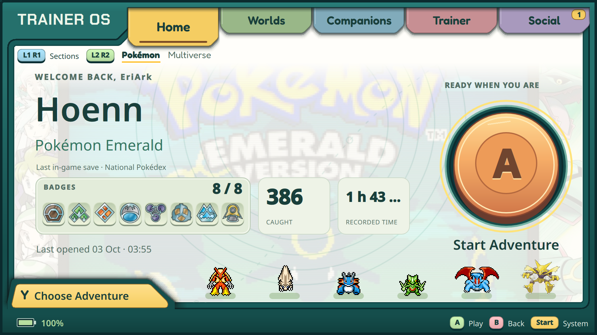

TrainerOS is the interface you boot into to play, talk to friends, use applications and manage the things around your games. It runs on Linux rather than replacing its drivers, Steam or maintenance desktop. The idea is simple: you should not have to switch to a separate desktop just to use a browser, move a file or answer a friend.

For an ordinary game, that can be as simple as **pick it → press A → play → press Home → return**.

For games TrainerOS understands more deeply, the boundary starts to disappear. Your party, progress, collections and history can live in the system around the game. Friends can see that you are playing, ask to join, and enter a supported multiplayer game without opening an emulator lobby or typing an IP address.

The first deep game integration connects a creature-collecting RPG to the shell beyond launch and exit. Ordinary games do not need such an integration to be good citizens: library, play history, Game Options, downloads and supported multiplayer remain useful on their own.

TrainerOS is still in active development, but the current build already runs as a dedicated handheld session on **Retroid Pocket Flip 2** and **AYN Odin 2**.

[Full-resolution handheld screenshots — 4 October 2026](screenshots/site-2026-10-04/README.md)

[Interactive website demo](web-demo/README.md) — a mouse-driven interface tour
with original fictional content and optional animated examples. The static bundle
can be served independently or embedded in a website; it does not run emulators
or connect to real accounts.

Agreed current direction: [TrainerOS product architecture (Russian)](docs/PRODUCT_ARCHITECTURE_RU.md). The [detailed original product vision](docs/PRODUCT_VISION_RU.md) remains as historical scope. The current source build and its dated device evidence are **not** the same as the newly approved UI/SDK designs.

## Development status and getting started

This repository currently provides **source and development deployment tooling**,
not a ready-to-flash public TrainerOS image. Prepared Flip 2 and Odin 2 installations
have real device evidence; that does not establish a fresh-install experience on
every handheld. Selected game artwork and names are blurred in the public screenshots; the surrounding interface is unchanged.

- [Build and run from source](docs/DEVELOPMENT.md)
- [Project status (Russian)](PROJECT_STATUS.md) · [Changelog (Russian)](CHANGELOG.md) — current capabilities, evidence and dated changes for posts and the website.
- [Documentation](docs/README.md) · [Contributing](CONTRIBUTING.md)
- [Current tasks and remaining acceptance](docs/CURRENT_TASKS.md) · [Roadmap](docs/ROADMAP.md)
- [Security reporting](SECURITY.md) · [Licensing and third-party materials](THIRD_PARTY_NOTICES.md)

| Area | Current boundary |
| --- | --- |
| Library, series and handheld shell | Installed device evidence; compatibility depends on available runtimes/content |
| Semantic game integration | Exact supported game/build adapters, not all games on a platform |
| Social and multiplayer | Implemented routes with bounded evidence; distinct-network, larger-group and human audio acceptance remain open |
| Apps / integrated OS workspace | Browser, Files, Quick Apps and Crates have accepted product designs; parts remain in development and are not all present in the current main build |
| Platform SDK / Network Fabric | Approved future developer integration (#235–244), not a public API or an installed relay service |
| Public distribution and updates | Armada image and SteamOS/Bazzite installer remain planned; updates, rollback and repair still require release acceptance |
| Code license and public artwork | Original code: GPL-3.0-or-later; third-party terms remain separate and artwork review is ongoing |

## Pick a game and play

The installed development build already organizes personal and series collections alongside a general Multiverse, with covers, previews and regular launch/return. **The next Games design** brings collections and platforms together, with Wheel, List, Grid and Shelves views. The global Y drawer is for Recent Games/Favorites; choosing a game to show on Home is separate from launching it.

<table>
<tr>
<td width="50%">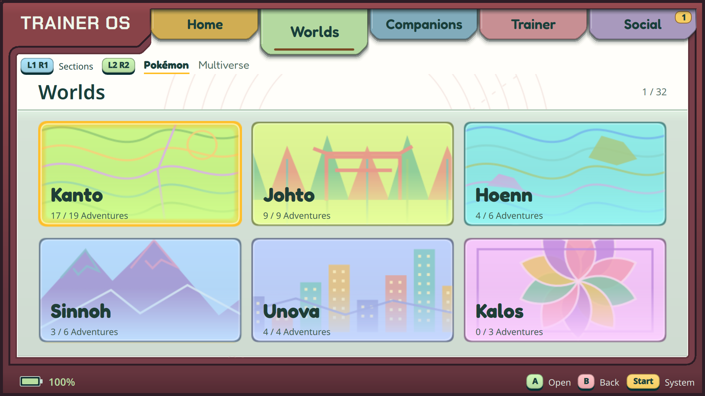</td>
<td width="50%">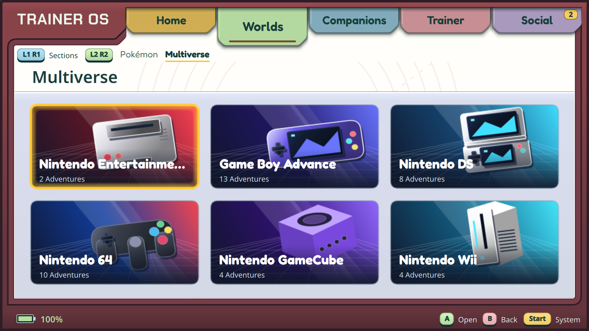</td>
</tr>
</table>

There is no normal setup screen between the library and the game. If a game is ready, **A launches it**.

TrainerOS keeps emulator paths, cores, command lines and room settings out of the everyday interface. Press Home while playing to open Game Options: continue, minimize and browse TrainerOS, invite someone when multiplayer is available, or exit cleanly. Returning to a minimized game restores the same running process; a universal pause is not promised.

Your ordinary game save stays the ordinary game save. TrainerOS does not make savestates the center of the experience.

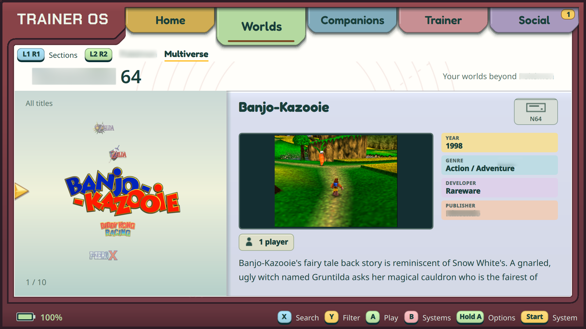

The general library can use Batocera-style folders and existing metadata, artwork and local video previews. Player-count information can be shown where it is known, and games with supported multiplayer can expose it directly from the library instead of making you remember which emulator happens to support what.

## Chat, invite, play

**Social is built into TrainerOS.** It is not a link that throws you into another app.

Messages brings direct and group conversations together; Communities and Discover stay alongside it. A compact composer leaves room for the conversation: write and send, attach a picture, choose emoji or record a voice message. Call from the header; open a person's name for their Fluxer profile. Touch and controller controls work in parallel.

<table>
<tr>
<td width="50%">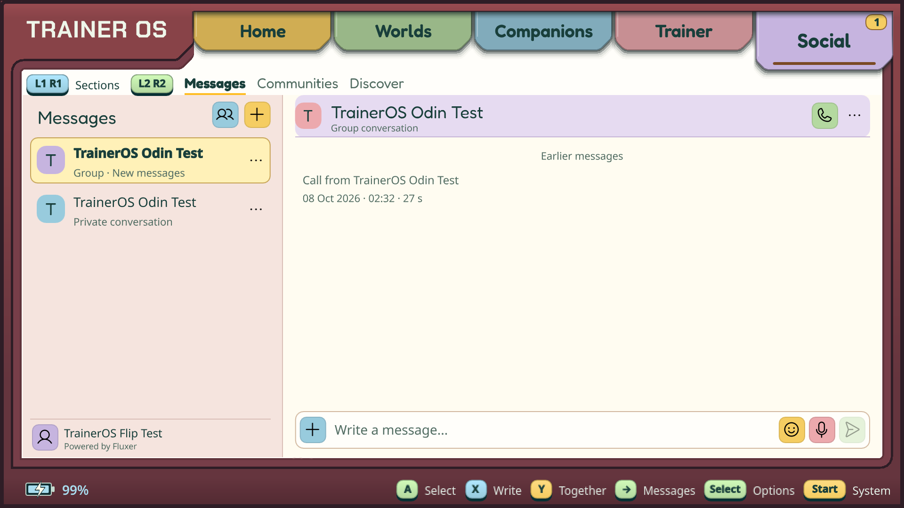</td>
<td width="50%">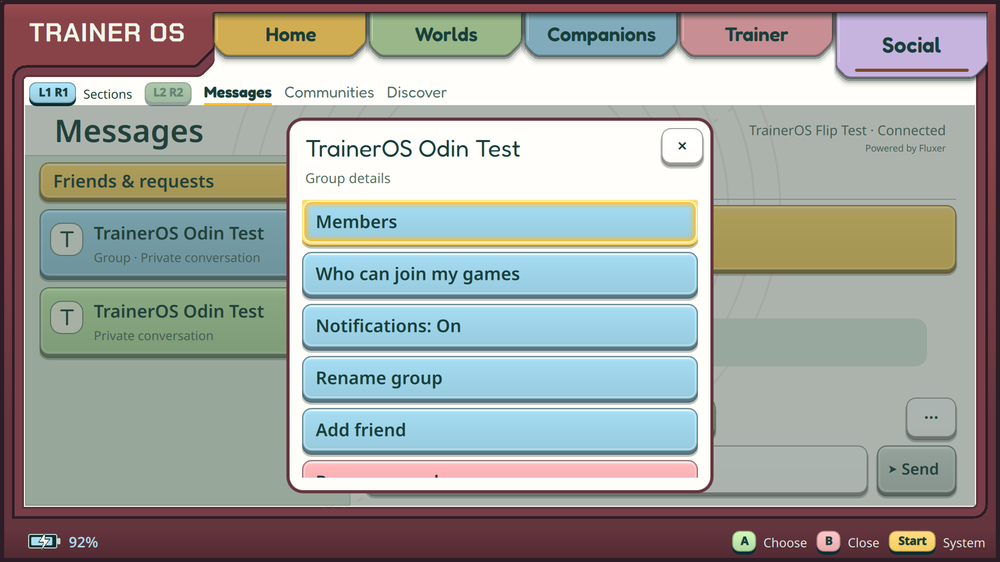</td>
</tr>
</table>

And the chat actually knows about games.

The current development build already supports sending invitations from a conversation, joining supported multiplayer sessions and returning to a running host where its runtime allows it. In the agreed next interface, **GameHub → Lobby** becomes the one common room for players, Ready, spectators and supported NetPlay/Remote Play, while Social stays the place for conversations, friends, groups and voice. You won't need to navigate a second set of network settings for every emulator.

TrainerOS handles the rest underneath. No copying IP addresses. No emulator room browser. No asking your friend which core they launched.

You can also invite from the context of a game or a live session. The exact path depends on the current build and the game's verified capabilities; the shell keeps your running game and conversation context separate.

If you leave a supported match while the host keeps playing, the conversation can show the open place again so you can **Join game** and return to the same running host. Groups can keep their chat and membership while different game parties start and end inside them. Selected members can be allowed to join your games without making you approve the same person every time.

A group voice call is separate from a particular match, so the same friends can keep talking while somebody changes games, leaves a party or joins another one.

Real paired gameplay has already been exercised on handhelds with several classic console games, PSP Lumines and supported multiplayer titles. Some supported games can prepare three or four player seats as well. Compatibility is still being expanded and verified game by game; TrainerOS does not label every multiplayer ROM as online-capable just because an emulator can launch it.

## Adventures continue outside the game

The first supported Adventure shows how a playthrough can connect to the OS.

With a supported save, the creatures you see in TrainerOS are the same ones that are in your game.

<table>
<tr>
<td width="50%">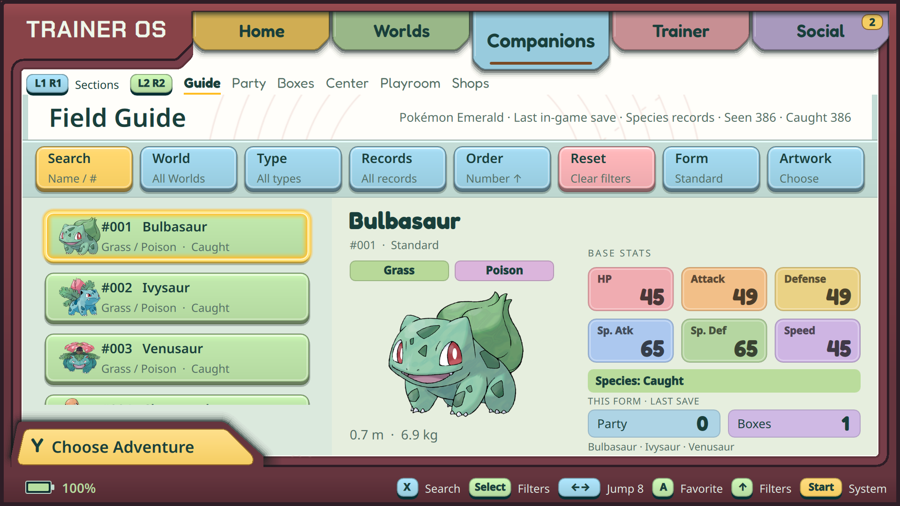</td>
<td width="50%">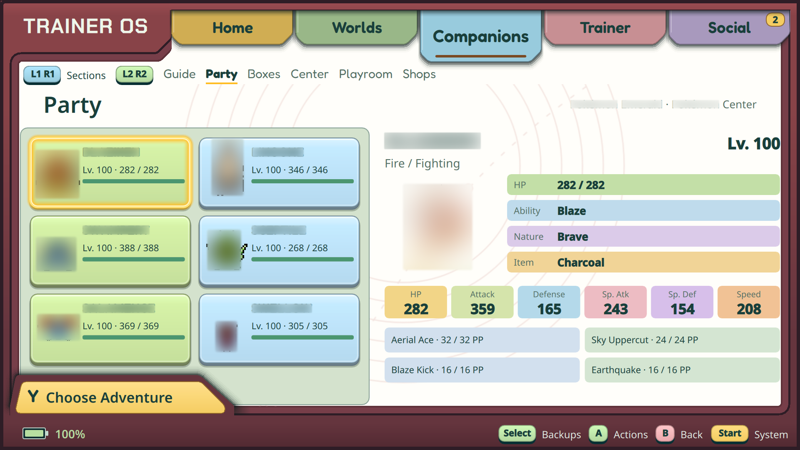</td>
</tr>
</table>

The **Field Guide** can show real Seen/Caught progress. **Party** shows the actual six party members. **Boxes** reads the real storage. **Journey** can follow real badges and milestones.

The connection also works in the other direction.

From TrainerOS, supported saves can already be healed, creatures can be moved between Party and Boxes, occupied slots can be swapped, held items can be managed, Boxes can be renamed, and protected releases can be performed. Shops and services can spend the game's real currencies and put the purchased result into the real save.

Launch the game afterwards and the game sees the change.

<table>
<tr>
<td width="50%">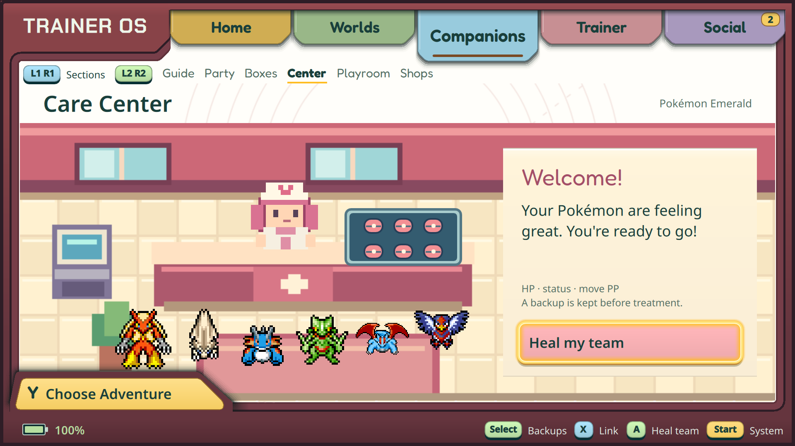</td>
<td width="50%">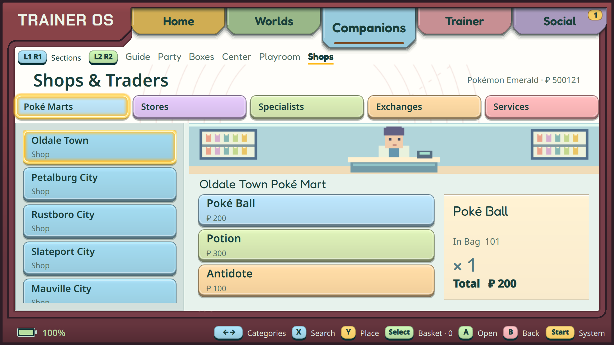</td>
</tr>
</table>

The **Playroom** is deliberately less practical. It gives the real current party somewhere to exist on the handheld outside battles — moving around, reacting and simply being present instead of turning every party screen into another spreadsheet.

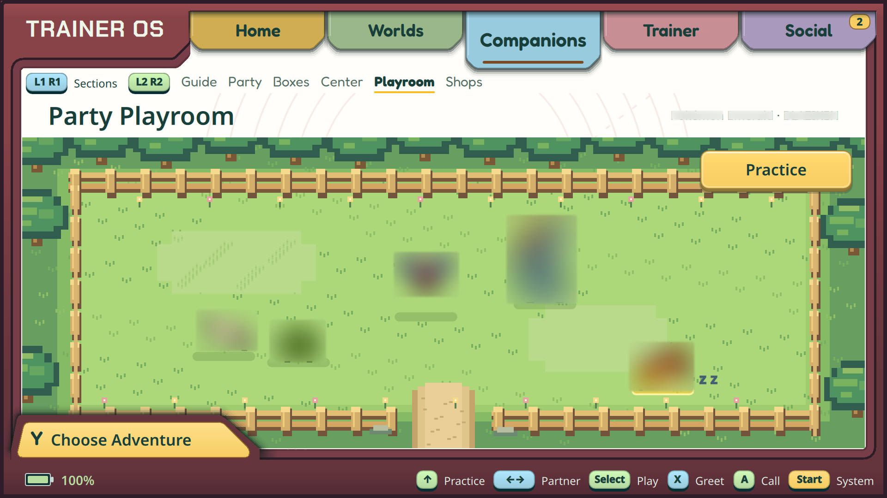

TrainerOS also has its own **Link** activities. Two nearby TrainerOS handhelds have already completed protected trades, gifts, creature sales, native trade evolutions and full-team battles using the real saves. That is separate from ordinary emulator multiplayer: persistent creatures moving between two Trainers needs its own safeguards and recovery.

## One Trainer across many games

A **Trainer** belongs to the person using the handheld, not to one ROM.

Multiple local Trainers can have their own profiles, optional PINs, history, navigation state and accounts while sharing the same installed game library. The first isolated ordinary-save route is already working for one supported emulator runtime, with more runtimes planned to follow.

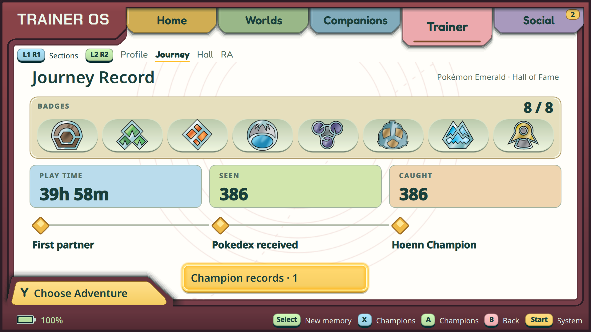

**Journey** keeps the larger story: current progress, milestones and eventually the pieces worth remembering after a particular save has moved on. Hall records and RetroAchievements remain their own sources instead of being mixed together into invented progress.

The intended end state is that your Trainer can survive the device too: export it, restore it after a reflash, or move it to another supported TrainerOS handheld without treating the whole system as disposable.

## Each series can have its own experience

The ordinary game library is a full part of TrainerOS, not a waiting room for titles without special integration.

A game can simply have a good cover, video preview, play history, direct launch, Home menu and clean return. That is enough.

The installed framework already hosts the Pokémon experience and a general fallback. In the new GameHub model, a title may optionally supply its own Adapter screens for genuinely game-specific features; that is *extra*, not a condition for ordinary play. Test modules do not establish support for other commercial games.

Installed Steam games are intended to sit alongside other games when enabled, while Steam remains available for the things Steam does best. TrainerOS does not need to reimplement Steam to make the handheld feel consistent.

## More than a game launcher

The agreed interface has five main spaces: **Home, Games, GameHub, Social and Apps**. GameHub brings information, achievements, optional game-specific tools and the shared Lobby together. Apps brings normal applications, the curated **Crates**, a browser and a file manager together.

The interesting part is how they cooperate. Say someone invites you to a multiplayer game and you are missing your own copy: you can keep the conversation and Lobby context, use Files or the browser to import a game you own, follow the task in the shared Downloads manager and return. You should not need to leave TrainerOS for a separate desktop every time you want to do something ordinary.

**Home** is the system's context-aware Options surface, or Game Options while a game is running. **Start** is planned as a shared grid for **QuickActions / Extensions**; **Quick Apps** provides a quick dock for applications. Those designs are being implemented in stages and are **not** what the older screenshots below show.

First run already walks through controls, optional Wi-Fi/Bluetooth, date and time, game storage, Trainer creation and an optional PIN. It can continue offline and resume if setup is interrupted.

<table>
<tr>
<td width="50%">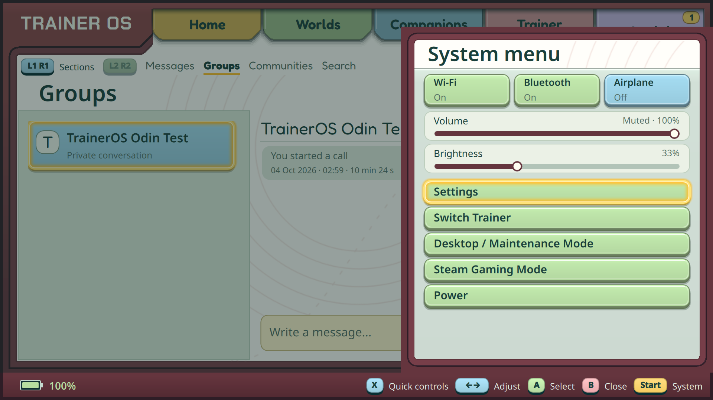</td>
<td width="50%">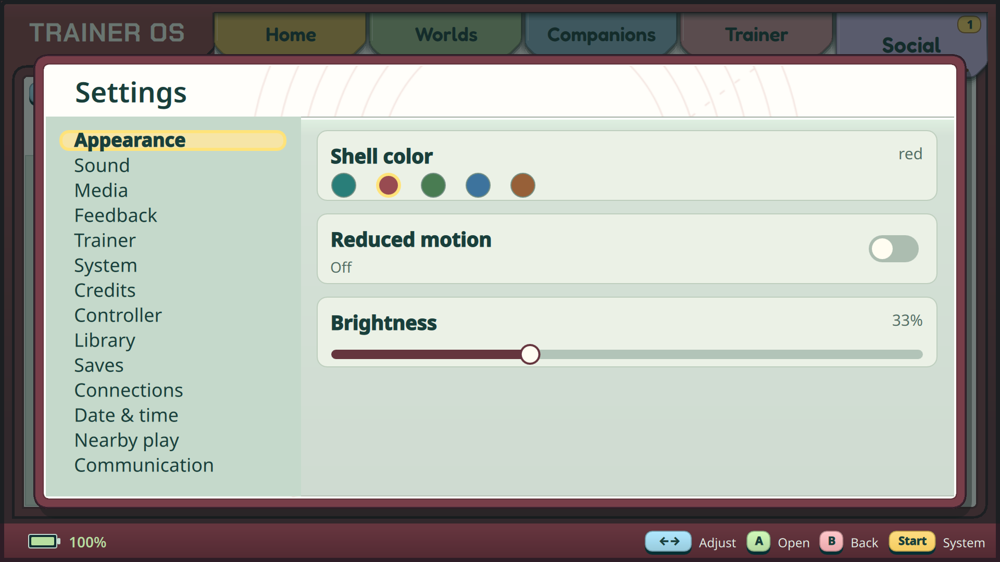</td>
</tr>
</table>

*These captures show the installed October 4 interface, before the new Start/Settings redesign.* The current development build still contains earlier menu components. Plasma remains available for maintenance and recovery, and Steam is not removed.

The idea is not to remove Linux. It's to give the everyday things you use Linux for a proper place inside a gamepad-first system.

## Where it is going

The public form of TrainerOS is intended to be a **ready-to-use ArmadaOS-based system image** for supported handhelds, not a weekend of manually installing a frontend and configuring a dozen emulators.

On first boot: choose the basics, point TrainerOS at internal or removable game storage, create your Trainer and start using the device. Supported emulator setups belong in the image. Your ROMs, firmware, saves and personal media remain yours.

The remaining work before public distribution includes reproducible installs, updates and recovery, portable Trainer backup/restore, wider device and multiplayer validation, and the new shared Apps/Home/GameHub interface. A separate longer-term direction is an optional **Platform SDK and Network Fabric**, allowing small games and extensions to reuse the shell's Lobby, social, file and media features without each needing a custom server.

What already exists is deliberately kept separate from what is merely planned. TrainerOS may know that a game launches without claiming it understands the save. It may know that a game has four players without claiming four real TrainerOS users have completed a session. Unsupported things stay unsupported instead of becoming optimistic buttons.

For the current implementation status and the long version of what remains, see the [Roadmap](docs/ROADMAP.md). For the much nerdier development evidence, the [project docs](https://github.com/EriArk/TrainerOS/tree/main/docs) are there on purpose so this README does not have to become one.

---

TrainerOS does not ship commercial ROMs, BIOS files, commercial saves or private ripped media.

TrainerOS is an unofficial fan-made project and is not affiliated with game publishers, Retroid, AYN, ArmadaOS, Valve, Fluxer, ScreenScraper, RetroAchievements, Libretro or the emulator projects it can work with.

Original TrainerOS code is licensed under **GNU GPL version 3 or later
(GPL-3.0-or-later)**. See [LICENSE](LICENSE), [scope and redistribution](LICENSING.md)
and [third-party notices](THIRD_PARTY_NOTICES.md). This software license does not
grant rights to game artwork, media or trademarks.
