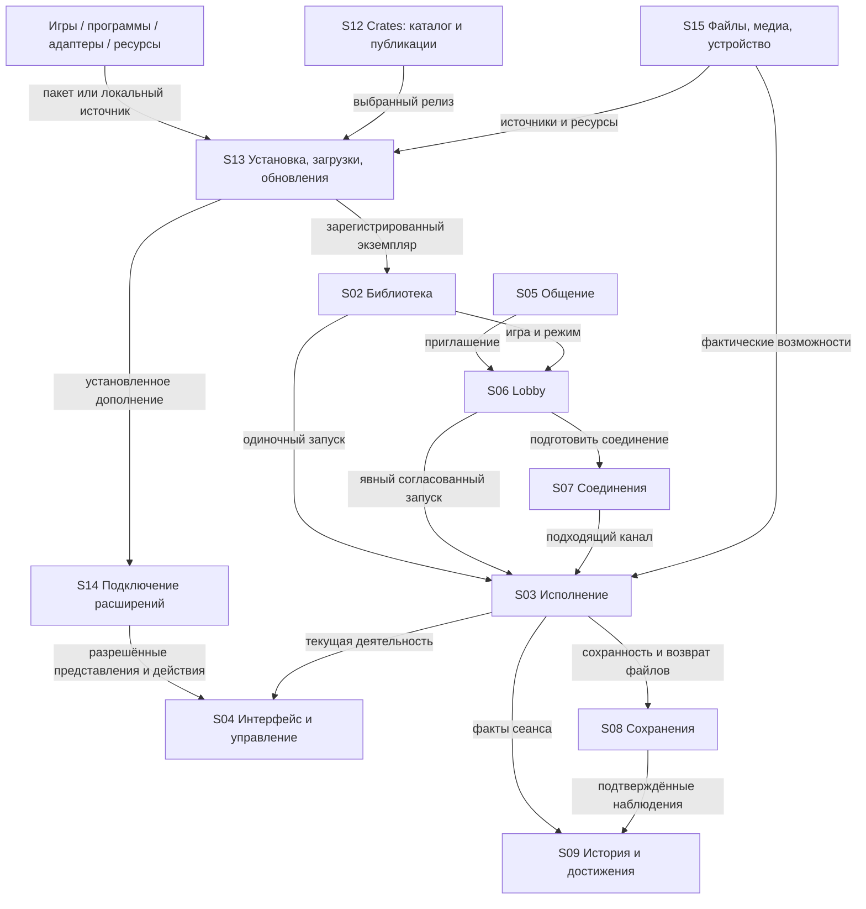
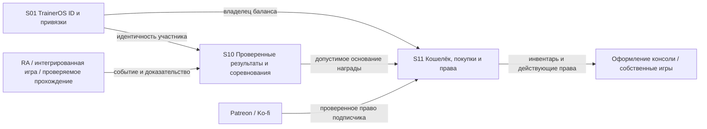
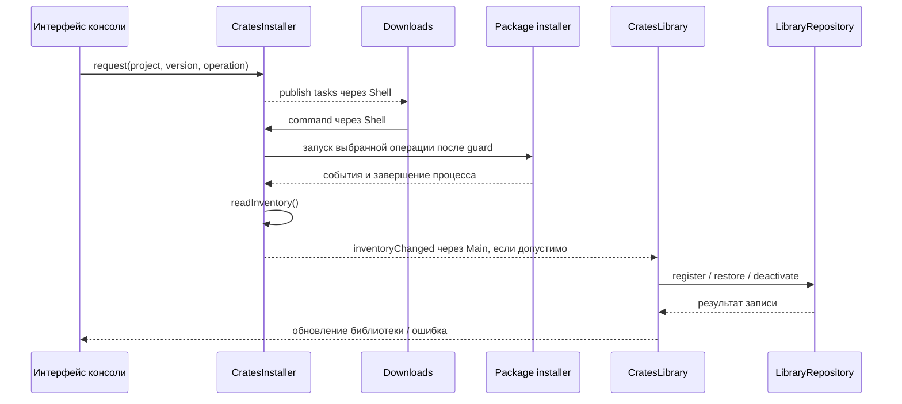

# Структура TrainerOS: владельцы, контракты и связи

**21 октября 2026. Карта согласованной конечной структуры со сквозными цепочками.**
TrainerOS — консольная экосистема с общими правилами, сервисами и точками подключения.
Часть функций принадлежит самой консоли; игры, программы и адаптеры используют их.
Карта описывает владельцев и зависимости, а не глобальную очередь разработки.

Для каждой функции прослеживается цепочка:
**владелец → вход/выход → зависимости и потребители → жизненный цикл → код → готовность**.
ID `S01–S15` обозначают логическую ответственность, а не новые процессы, классы
или микросервисы. `E01–E23` — связи между владельцами; `F01–F12` — сквозные цепочки.
Имена полей ниже обозначают
смысл данных, не объявляют готовый публичный SDK или новую схему БД.

- [Готовность функций](FEATURE_READINESS.md) — фактические результаты и остаток;
  у каждой строки указан основной владелец и затрагиваемые узлы этой карты.
- [Продуктовый контракт](PRODUCT_ARCHITECTURE_RU.md) — принципы и согласованный объём.
- [Экранные решения](PRODUCT_SPEC.md) — где пользователь видит функции.
- [Техническая архитектура](ARCHITECTURE.md) — существующие механизмы.
- [Сквозные цепочки](#flows) — переходы, фактические точки подключения и остаток.
- [Покрытие всех issues](REQUIREMENTS_COVERAGE_RU.md) — issue → R-готовность → S-владелец → F-переход.
- [Обратная карта влияния](#impact) — какие цепочки учитывать при изменении узла.

## 1. Общая схема

Стрелки показывают подписанные обращения/события, а не передачу владения данными.
Профиль S01 задаёт контекст владельца для личных операций во всех узлах.
S04 представляет функции; расположение экрана не делает его владельцем их данных.

Экономический контур связан с играми, но имеет собственную проверку событий:

## 2. Владельцы функций и состояния

| ID / система | Единолично отвечает за | Принимает → предоставляет | Граница ответственности |
| --- | --- | --- | --- |
| **S01 Игрок и идентичность** | Локальный Trainer, выбор владельца, привязки; целевой TrainerOS ID и восстановление доступа | Вход/смена профиля → контекст владельца и допустимый доступ | Локальный Trainer работает офлайн. Fluxer ID не равен TrainerOS ID; баланс хранит S11. |
| **S02 Библиотека** | Идентичность игры/программы, экземпляры, коллекции, избранное, связи с runtime | Импорт/установка/каталог → карточка, выбор экземпляра, доступные действия | Название и коллекция не дают совместимость, права на save или multiplayer. Исторические идентификаторы сохраняются. |
| **S03 Исполнение** | Реальная деятельность, процесс/сеанс, подготовка runtime, возврат и завершение | Запрос запуска с owner/game/runtime → подтверждённый сеанс и его исход | Геймплей и синхронизация остаются игре/runtime. Выбранная карточка не подменяет запущенную игру. |
| **S04 Оболочка и управление** | Пять разделов, маршруты, системные кнопки, фокус, клавиатура, Home/Start, уведомления | Состояние сервисов/разрешённые UI-вклады → отображение и семантические действия | Экран не становится второй БД профиля, комнаты или пакетов. Ввод игры принадлежит действующему сеансу. |
| **S05 Общение** | Интеграция друзей, сообщений, сообществ, вызовов, presence и медиа провайдера | Пользовательские действия/Fluxer events → переписка, звонок, приглашение | Fluxer остаётся источником своих членств/прав. Звонок и переписка не принадлежат игровому процессу. |
| **S06 Lobby и совместные занятия** | Комната, состав, выбор занятия, места, Ready, допуск и повторный вход | Приглашение/выбор/готовность → подготовка и явный Start хозяина | Комната существует между играми. Единый обычный multiplayer вход; специфический семантический Link остаётся действием адаптера. |
| **S07 Соединения** | Подготовка поддерживаемого канала, endpoint/session binding, состояние соединения | Согласованный режим/участники → канал для runtime или приложения | Использует готовые netplay/P2P/native services. Не реализует универсальную игровую симуляцию. Fluxer media не считается произвольным relay. |
| **S08 Сохранения и целостность** | Привязки личных saves, backup/restore, protected-write/recovery, lineage | Сеанс или точная разрешённая операция → сохранённые файлы и проверенный результат | Обычные saves принадлежат пользователю/игре. Семантическую операцию знает адаптер; допуск и commit контролирует host. |
| **S09 История и достижения** | Факты игры, My Story/Timeline/Gallery, проекции прогресса и достижений с источниками | События сеанса, RA, проверенные наблюдения → личная история и представления | Пользовательская запись и импортированный прогресс не являются доказанной денежной наградой. |
| **S10 Проверенные результаты и соревнования** | Целевые правила приёма событий, повторов/аннулирования, зачётов/рейтингов/турниров | Событие с доказательством и идентичностью → подтверждённый результат/основание награды | Формулы, Arcade Today, кланы и части верификации ещё требуют решения. Наличие lineage не означает готового античита. |
| **S11 Экономика и права** | Серверный баланс/журнал, покупки, инвентарь, правила начисления и преимущества подписки | Основание награды/покупка/проверенная подписка → подтверждённая операция и права | Клиент не назначает баланс. Магазин открыт всем, множитель до ×3, приобретения сохраняются; без pay-to-win/прямой продажи монет. Тарифы не определены. |
| **S12 Crates и публикации** | Курируемый каталог, проекты/релизы, размещение, сведения об авторах, reviews/Top Rated | Одобренная публикация, каталог, допустимый отзыв → предложение установки и сведения о проекте | Установленные файлы принадлежат учёту S13. Донат автору не равен подписке TrainerOS. Reviews используют существующий Fluxer механизм. |
| **S13 Доставка и обслуживание** | Общие представление/команды заданий; исполнители владеют своей очередью/транзакцией. Версии/зависимости/целостность, активные пакеты, update/remove/recovery | Выбранный источник/версия/операция → результат задания и изменение inventory | Downloads не исполняет установку. Crates — один источник/исполнитель. Image/host, TrainerOS Software, игры и пользовательские данные имеют разных владельцев обновления. |
| **S14 Расширения и контракты** | Совместимость, регистрация, доступ к существующим сервисам и разрешённым UI-точкам, отключение | Manifest/descriptor/контекст → действующие возможности и вклады пакета | Адаптер, runtime-интеграция и SDK-приложение — разные роли. Local SDK preview даёт context/Start widget; остальные facades/#92/SPI открыты. Built-in API не объявляется внешним ABI. |
| **S15 Среда устройства** | Общие файловые/медиа/аппаратные службы: места хранения, звук, питание, сеть устройства, диагностика | Фактические host capabilities/запросы → доступные операции и состояние | Использует Armada/Linux. Не выдумывает поддержку устройства и не делает Desktop Mode обязательным для обычных действий. |

Пользовательские материалы отделены от заменяемого кода. Системы S01/S10/S11 могут
иметь серверные части; это не делает обычный запуск зависимым от backend.
Собственные игры используют те же границы. Эксклюзивная интеграция означает
зависимость от реально используемых возможностей платформы, без искусственного DRM.

## 3. Реестр связей и передаваемый контекст

При изменении узла проверять затронутые входящие **и** исходящие связи. Потребитель
обрабатывает отсутствие/отказ сервиса; success означает подтверждённый результат.

| Связь | Откуда → куда | Смысл контракта | Завершение / защита от неверного контекста |
| --- | --- | --- | --- |
| **E01** | S01 → остальные S | owner, привязанный account, актуальность контекста | Смена Trainer отменяет устаревшие callbacks; чужие данные/токены/права не переносятся. Политика смены при живом сеансе требует явного допуска. |
| **E02** | S12 или локальный источник → S13 | Намеренная установка: project/package, version, source, compatibility | Открытие каталога не запускает Download/Update. Отмена не создаёт установленный пакет. |
| **E03** | S13 → S02/S14 | Успешная активация: installation, version, roles, owned paths | Карточки/вклады регистрируются по факту; ошибка обновления сохраняет пригодную версию и личные данные. |
| **E04** | S02/S06 → S03 | owner, игра/экземпляр, runtime/mode, return context; при multiplayer — session/seat | Проверка готовности перед запуском; выбранная игра и запущенная игра имеют независимую идентичность. |
| **E05** | S03 ↔ S04/S15 | session/process, foreground/input ownership, Home/return/exit | Потеря процесса освобождает ввод. Home/Minimize не объявляют pause/save. |
| **E06** | S05 → S06 | Приглашение/намеренный Join с комнатой, actor и условиями доступа | Presence не запускает игру. Отказ/истечение приглашения не меняет голос или save. |
| **E07** | S06 → S07/S03 | Состав/места, подтверждённый режим, runtime/content compatibility, состояние подготовки | Ready разрешает отдельный Start хозяина. Потеря связи/rejoin повторно проверяет допуск; не восстанавливает место по одному старому кешу. |
| **E08** | S03 ↔ S08 | owner/game/build/session, runtime save paths, наблюдаемый исход | Пока игра владеет save, внешняя семантическая запись запрещена. Краш не считается успешным сохранением. |
| **E09** | Адаптер через S14 → S08 | Точная операция, build/source revision, owner, входные данные | Backup → разрешённая запись → readback/recovery. Presentation match не даёт write capability. |
| **E10** | S03/S08/RA → S09 | Факт, источник, owner/game/session, время/достоверность | Проекция сохраняет unknown; историческое событие не выдаётся за новую проверку. |
| **E11** | Игра/RA/проверяемое прохождение → S10 | Идентичность события/участников, результат и поддерживаемое доказательство | Повторы, конфликт и неподтверждённое событие не превращаются в победу/награду. Точные политики ещё открыты. |
| **E12** | S10 → S11 | Принятое основание начисления, rule/version, уникальность операции | S11 рассчитывает и фиксирует начисление один раз; порядок исправлений/возвратов требует определения. |
| **E13** | Patreon/Ko-fi + S01 → S11 | Проверенная привязка и действующее право поддержки | Отмена прекращает временные преимущества; покупки/остаток не удаляются. Локального флажка недостаточно. |
| **E14** | S11 → S04/игра | Инвентарь и права на конкретное оформление/предмет | Каждый потребитель применяет совместимые предметы. Общий баланс не означает совместимость каждого предмета со всеми играми. |
| **E15** | Дополнение → S14 → S04/сервисы | Роль, совместимость, именованный вклад, owner/game/session context | Disable/update/remove снимают вклад и stale actions; fallback сохраняет игру и личные данные. |
| **E16** | Files/Browser/PC/ScreenScraper → S13/S15 | Provider/task identity, источник, назначение, progress и поддерживаемые команды | Downloads показывает опубликованные задания и направляет команды владельцу. Отмена/очередь/хранение остаются исполнителю; закрытие панели не отменяет работу. Не требовать нового общего планировщика. |
| **E17** | S09/S13 → S12 | Доказательства eligibility: Crates install history либо отдельная non-Crates play/completion policy | Crates: любая прежняя установка, без 2h gate; account+project score один на все версии. Non-Crates имеет отдельную политику F10; валюта не даёт право отзыва. |
| **E18** | S06 ↔ S05/S07 | Зритель/игрок, разрешения на media/input, текущий поток/место | Spectator через Fluxer и interactive Remote Play через P2P различны; смена роли требует нового допуска. |
| **E19** | S06/S07/S13 ↔ S08/S03 | Guest-content lease, content identity, временное размещение и допустимый сеанс | Временный контент не регистрируется как постоянная собственная игра; конец lease/сбой имеет отдельную очистку и сохраняет личные saves по принятой политике. |

| **E20** | Автор/издатель → S12 → S13 | Принятый project ID, immutable release assets, подпись и revision; withdrawn | Первый проект курируется; следующая версия через существующий publisher. Отзыв каталога не удаляет установленный пакет; F09. |
| **E21** | S12 ↔ S05; S15 → S12 | Provider-owned review ID, project/content identity, stars/text и preview device/arch/version | Edit/delete/report через Fluxer; Top Rated производен от того же источника, без отдельного account/голоса; F10. |
| **E22** | Программа ↔ S14 ↔ S06/S07/S15 | Versioned discovery/capabilities, service/contribution IDs, owner/session/generation | Local v1 bridge/context/widget реализован; Network/Lobby/Files/Media facades ещё target. Host снимает bindings, app владеет данными/симуляцией. F11; не универсальный ABI. |
| **E23** | S15/перезапуск/provider loss → затронутые владельцы | Причина прерывания, сохранённая operation identity и фактический исход каждого сервиса | Каждый владелец восстанавливает своё состояние; общий экран успеха не доказывает процесс/save/channel/call/job. F12. |

## 4. Подключаемое содержимое: вход, работа, выход

Один пакет может совмещать роли. Для обычной Linux-программы не обязательны SDK,
Crates, особый аккаунт или отдельный сервер. Сервисы подключаются по потребности.

| Роль | Вход | Что принадлежит содержимому | Точка выхода и сохраняемое состояние |
| --- | --- | --- | --- |
| Игра / программа | S13 установка или S02 регистрация существующего экземпляра; запуск S03 | Геймплей/документ/уникальная логика, собственные пользовательские данные | Завершение процесса/деятельности, возврат и освобождение ресурсов; профиль/история остаются. |
| Runtime-интеграция | Обнаружение совместимого runtime и режима; запрос S03 | Конфигурация исполнения, команды запуска, особенности ввода/save/netplay | Остановка helpers, освобождение ввода и временной конфигурации; результат обратно S03/S08. |
| Experience-адаптер | S14 manifest match точной игры; выбранный owner/game context | Семантика игры, представления/действия, внутренняя навигация, schema своих материалов | leave/context change/disable: stale callbacks отменяются, host использует fallback. Семантические транзакции завершаются через S08. |
| Виджет / игровой инструмент | Разрешённая UI-точка S14/S04, при необходимости живой session context | Собственное компактное представление/действие | Снятие вкладов/подписок; нет оставшихся кнопок, захвата ввода или действия против другой игры. |
| File/media/service provider | Подключение к соответствующему сервису S15/S13 через контракт S14 | Доступ к своему источнику/специальной операции | Отключение источника с явным результатом заданий; независимые локальные данные остаются. |
| Оформление / asset pack | Установка S13, выбор совместимым потребителем | Ресурсы и schema/entity mapping своего семейства | Возврат к доступному набору; пользовательский pack хранится отдельно от обновляемого кода. |

**UI-точки подключения:** Home — вклад текущего Experience; GameHub — именованные
экраны Adapter; Start — согласованные виджеты; Game Options/HUD — session-bound
инструменты; Files/Media — источники через соответствующий сервис. Host сохраняет
пять основных разделов, navigation/input правила и обычные Overview/RA/Lobby.
Built-in Experience реализован; внешние SPI/SDK-вклады требуют своих контрактов.
Детальные роли, service boundary и выход — [F11](#f11). Пользовательский путь
для установленного расширения — uninstall через Settings Installed Software;
обычного enable/disable нет. Внутренняя quarantine остаётся отдельным случаем.

## 5. Независимые сущности и жизненные циклы

| Различать | Правило связи |
| --- | --- |
| Local Trainer / TrainerOS ID / Fluxer account | Привязки, а не один общий идентификатор. Онлайн recovery и перепривязка ещё проектируются. |
| Игра / издание-build / экземпляр / личное прохождение | Общая карточка не разрешает смешивать saves или сетевые версии. Физическое хранение и миграции следуют действующей модели, не этой схеме автоматически. |
| Package/project / installation / library entry | Пакет может дать несколько ролей; карточка может ссылаться на уже установленное ПО вне Crates. |
| Выбранная игра / live session / процесс / foreground owner | Каждое действие привязано к нужной сущности и её актуальному поколению. |
| Комната / игровой раунд / conversation / call / transport connection | Конец игры не завершает комнату или звонок; потеря канала не означает добровольный выход участника. |
| Личная история / доказательство / принятое событие / начисление | История может существовать без права на проверенную награду; начисление принадлежит S11. |
| Подписка / купленная косметика / установленный пакет | Срок действия преимуществ не удаляет покупки и локальные программы. |

| Событие | Что обязано завершиться или измениться | Что сохраняется / отдельное условие |
| --- | --- | --- |
| Обычный Exit / crash игры | S03 фиксирует реальный исход, освобождает session-bound ввод/вклады; S08 различает успешный возврат и recovery | Профиль, комната, разговор; crash не создаёт фиктивный save/результат. |
| Смена игры в комнате | Новый выбор/места/readiness и проверки E07 | Членство комнаты и независимый call; нельзя без проверки переносить старый допуск. |
| Отключение/обновление адаптера | Старые вклады и callbacks больше не действуют; активная save-транзакция учитывается | Игра, обычные saves/история; generic fallback. |
| Update/remove пакета | Замена только принадлежащих пакету файлов, снятие регистрации по ролям, обработка busy use | Личные данные отдельно; удаление данных требует отдельного намерения. |
| Потеря provider/backend | Явная недоступность зависимых операций, ограниченный reconnect/retry | Обычный локальный запуск; экономический кеш не разрешает самовольные покупки. |
| Смена профиля / сон / перезапуск | Переоценка owner/session/input/network context | Нельзя считать старую комнату, save lease или доступ действующим без восстановления. Физическая приёмка сна открыта. |

## 6. Привязка к текущей реализации

Пути проверены в рабочей ветке `codex/apps-workspace`. **Есть код** означает
существование механизма, не полную готовность узла. PC/LAN/input/runtime содержат
отдельный незакоммиченный WIP; аппаратные результаты смотреть по сборке/дате.

| Узел | Существующая опора | Что ещё не является завершённым контрактом |
| --- | --- | --- |
| S01 | [TrainerController](../src/features/trainer/TrainerController.h), [TrainerRepository](../src/core/repository/TrainerRepository.h), [ownership](TRAINER_OWNERSHIP.md) | TrainerOS ID, recovery и online-привязки — [target](TRAINEROS_ACCOUNT_ECONOMY_RU.md). |
| S02 | [LibraryRepository](../src/core/repository/LibraryRepository.h), [SqliteLibrary](../src/core/storage/SqliteLibrary.h), [PC import](../src/features/pc/PcGamesController.h) | Общая совместимость всех изданий/форматов и автоматические коллекции не закрыты. |
| S03 | [Launch](../src/core/navigation/AdventureLaunchController.h), [Exit](../src/core/navigation/AdventureExitController.h), [runtime integrations](../src/integrations/adventure), [AppsController](../src/features/apps/AppsController.h) | Игры и обычные приложения имеют разные текущие исполнители. Общая ответственность за деятельность не означает, что все приложения уже проходят AdventureLaunchController. PC installer/runtime и часть multiplayer открыты. |
| S04 | [ShellController](../src/core/navigation/ShellController.h), [input](../src/platform/input), [контракт](CONTROLS78_HOME_START.md) | Все физические контроллеры/TV, Home во всех runtime и внешний contribution API не приняты. |
| S05 | [SocialController](../src/features/social/SocialController.h), [FluxerSession](../src/integrations/social/FluxerSession.h), [SocialMedia](../src/features/social/SocialMedia.h) | Реальная речь/гарнитура и отдельные provider/lifecycle сценарии открыты. |
| S06 | [LobbyCoordinator](../src/features/social/LobbyCoordinator.h), [LobbyRuntime](../src/features/social/LobbyRuntime.h), [directory bot](../services/lobby-directory/README.md) | Offline Lobby, полный rejoin/роль зрителя/все runtime не готовы. Физическое размещение в Social не меняет владельца комнаты. |
| S07 | [network](../src/platform/network), [OnlineLink](../src/integrations/social/OnlineLink.h), [remote-play transport](../tools/remote-play-stream/transport), [матрица](EMULATOR_MULTIPLAYER_MATRIX.md) | Общий Network Fabric SDK — target; разные сети/режимы и PC LAN WIP имеют отдельные границы. |
| S08 | [RuntimeSaveStorage](../src/platform/storage/RuntimeSaveStorage.h), [SaveBackupStorage](../src/platform/storage/SaveBackupStorage.h), [SaveLineage](../src/platform/storage/SaveLineage.h), [реестр адаптеров](adapters/README.md) | Все форматы/миграции, MP-02 и portable Trainer backup не приняты. |
| S09 | [SqlitePlayHistory](../src/core/storage/SqlitePlayHistory.cpp), [achievement integrations](../src/integrations/achievements), [RA](RA73_GAME_SELECTION.md) | Полный live unlock/history/media цикл не закрыт; общей экономической верификации здесь нет. |
| S10 | [Target соревнований](TRAINEROS_BACKEND_PLAN_RU.md), [правила доверия](TRAINEROS_ACCOUNT_ECONOMY_RU.md) | Готового общего сервиса матчей/турниров/наград не заявлено; правила и API открыты. |
| S11 | [Согласованная экономика](TRAINEROS_ACCOUNT_ECONOMY_RU.md) | Кошелёк, подписочные права и магазин — target, не установленный backend. |
| S12 | [CratesCatalogue](../src/features/crates/CratesCatalogue.h), [CratesController](../src/features/crates/CratesController.h), [FluxerReviews](../src/integrations/social/FluxerReviews.cpp), [поставка](CRATES77_CATALOGUE.md) | Полные reviews/Top Rated, публикации и donation UX не закрыты. |
| S13 | [CratesInstaller](../src/features/crates/CratesInstaller.h), [DownloadsController](../src/features/downloads/DownloadsController.h), [FilesService](../src/platform/files/FilesService.h), [PC](../packaging/pc/README.md) | Разные исполнители корректно публикуют свои задания через общий интерфейс. Полный набор команд/providers, software updater и installer/recovery не завершены; централизация всех очередей не требуется. |
| S14 | [ExperienceModule](../src/core/experience/ExperienceModule.h), [manifest](../src/core/experience/ExperienceManifest.h), [composition](../src/adapters/BuiltinExperiences.cpp), [правила](../src/adapters/AGENTS.md), [PlatformHost](../src/platform/sdk/PlatformHost.cpp) | Trusted built-ins и local SDK context/widget существуют; #92, SPI и остальные service facades #235–244 остаются незавершёнными контрактами. |
| S15 | [PlatformService](../src/platform/PlatformService.h), [device](../src/platform/device), [FilesService](../src/platform/files/FilesService.h), [power](../src/platform/power), [Apps](../src/features/apps/AppsController.h), [Browser](../src/features/browser/BrowserController.h) | Микшер, сон/recovery, providers и все host/device profiles не завершены. Apps/Browser — потребители общих служб, не отдельные владельцы профиля. |

## 7. Внешние системы и пределы их роли

| Внешняя сторона | Связь с TrainerOS | Что остаётся у консоли / игрока |
| --- | --- | --- |
| Fluxer | S05 сообщения/друзья/звонки, S06 signaling/directory, внешний вход S01 | Собственный TrainerOS ID, библиотека, saves, wallet. Доступные операции проверяются по provider API. |
| RetroAchievements | S09 достижения, источник допустимых доказательств S10 | Правила платформенных наград и денежный журнал S11. |
| Patreon / Ko-fi | Подтверждение поддержки для S11 | Свои права/инвентарь и их жизненный цикл; политика начислений определяется TrainerOS. |
| GitHub Releases / каталог Crates | Артефакты и опубликованные метаданные S12/S13 | Явное решение об установке и локальное inventory; VPS не становится зеркалом игровых архивов. |
| Steam / эмуляторы / Wine-Proton-FEX | Источник/исполнение через S02/S03 и поддержку версий S13 | Единый контекст запуска и возврата. Существующие пользовательские установки/сейвы сохраняются. |
| Linux / Armada и другие поддержанные hosts | S15 реальные файлы, устройства, процессы и capabilities | Консольный UX/общие функции; host updater не подменяется обновлением игры. |
| Backend TrainerOS | Целевые серверные части S01/S10/S11, метаданные S12 и directory | Обычные локальные игры работают независимо; тяжёлый owner-hosted media relay не становится обязательным. |

## 8. Открытые структурные вопросы

Это пробелы контрактов с указанными владельцами, без очереди исполнения:

| Владелец / связь | Что определить или проверить |
| --- | --- |
| S01 / E01,E13 | Перепривязка/recovery TrainerOS ID, несколько устройств, смена профиля при живой деятельности. |
| S02/S03/S07 / E04,E07 | Правила совместимости изданий для каждого режима. UI identity, точный save-build и сетевой допуск имеют разные условия; единый EXE hash нельзя автоматически переносить на все игры. |
| S10/S11 / E11–E14 | Допустимые события, правила наград/отмены/повторов, офлайн-события, тарифы и цены; обмен валютой/вывод/торговля не утверждены. |
| S10 | Правила Arcade Today, турниров, кланов и трофеев: критерии участия/результата/спора. |
| S12/S13 / E02,E03,E16 | Сохранить существующее разделение: каталог → исполнитель → inventory; Downloads — представление/маршрутизация. Уточнить восстановление при разрыве между активацией пакета и регистрацией карточки, полный набор команд каждого provider. |
| S12 / E20,E21 | Подача нового стороннего проекта и передача publisher authority; V2/история установки, точное project-content соответствие, дубли отзывов и формула Top Rated. Готовые publisher/V1 механизмы сохранить; F09/F10. |
| S14 / E15 | Версии service/contribution контрактов, установка внешних адаптеров/SPI, отзыв/изоляция вкладов и миграции данных. Текущий C++ built-in интерфейс не равен публичному SDK. |
| S06/S07 / E07,E18 | Rejoin/смена ролей/поздний вход; прямое соединение между сетями и честный результат при неподдерживаемой сети. |
| S06/S08/S13 / E19 | Полная guest lease/policy/cleanup цепочка при сбое без потери собственного прогресса. |
| S03/S04/S15 / E05 | Единое освобождение ввода/оверлеев при завершении, смене foreground, сне и восстановлении. |

## 9. Сквозные цепочки и точки перехода

В каждой цепочке **есть в исходниках** и **конечное требование** разделены.
Названные методы — проверенные точки входа, а не новый унифицированный API.
Переходы не являются порядком разработки. Чтение кода не заменяет запуск теста
или проверку установленной сборки; статусы готовности этим дополнением не меняются.

### F01. Каталог/локальная папка → установленное содержимое → запуск

**Участники:** S01, S12, S13, S02, S14, S03, S04, S15; E02–E05,E15,E16.

| Переход | Текущая точка подключения и результат | Остаток / граница |
| --- | --- | --- |
| Проект/версия → намеренная установка | `CratesInstaller::request()` создаёт job; `pump()` учитывает `replacementGuard`. [Код](../src/features/crates/CratesInstaller.cpp). | Каталог сам не устанавливает обновления. Текущий guard ждёт завершения игры/save-операции; это ещё не точная занятость конкретного пакета. |
| Исполнитель → общая панель | Shell публикует `tasks()` под provider `crates`; `DownloadsController::commandRequested` возвращает команду установщику. Files/Browser подключены аналогично. [Связи](../src/core/navigation/ShellController.cpp), [контракт панели](../src/features/downloads/DownloadsController.h). | Общая панель не получает права на повторную независимую установку/отмену чужого job. Возможности команд зависят от provider. |
| Успешная транзакция → установленная версия | [Package installer](../packaging/crates/installer.py) проверяет/распаковывает объект и заменяет active receipt; `readInventory()` читает receipts и выдаёт `inventoryChanged`. | Результат установки и результат регистрации в библиотеке — два наблюдаемых перехода. Ошибка второго не делает первый несуществующим. |
| Inventory → карточка игры | `Main.cpp` связывает inventory с `CratesLibrary::update()`; reconcile использует `crates:<project>`, restore/deactivate и сохраняет identity/history. [Composition](../src/app/Main.cpp), [согласование](../src/features/crates/CratesLibrary.h). | Reconcile откладывается на время живой игры. Полный recovery при ошибке записи карточки остаётся проверяемой границей. |
| Play/Open → правильный исполнитель | `CratesController::launchRequested`: game → `launchPreparation().launch()`; app → `AppsController::openDesktopId()`. | Общая консольная ответственность не требует превращать обычное приложение в Adventure. Выход — F02. |
| Локальная готовая PC-папка → та же библиотека | `PcGamesController::registerGame()` проверяет executable/runtime, создаёт `pc:<id>` и вызывает `saveAdventureAsync`; успешный callback выдаёт `saved`. [Код](../src/features/pc/PcGamesController.cpp). | Мастер EXE/MSI и архивы пока не заменяются этим путём. Внешние роли пакетов/SPI — отдельная незавершённая ветка F03. |

### F02. Запуск → Home/возврат → завершение

**Участники:** S01, S02, S03, S04, S08, S15, S09; E01,E04,E05,E08,E10.

Для игры `AdventureLaunchController::launch()` сохраняет контекст и запрашивает
checkpoint. Только успешный `checkpointCompleted()` запускает процесс; только
`ProcessService::started` создаёт `adventureStarted` и переводит сеанс в `running`.
Это граница между намерением запуска и фактической игрой.
[Текущий код](../src/core/navigation/AdventureLaunchController.cpp).

Minimize сохраняет тот же сеанс. Обычный Exit проходит через
[AdventureExitController](../src/core/navigation/AdventureExitController.cpp).
При завершении различаются **процесс закончен**, **данные подтверждены** и
**можно вернуться/готовить следующую игру**. В PC WIP явное закрытие с code 130
может разрешить продолжение Lobby, сохраняя unclean save/frame outcome; это не
доказательство сохранения внутри игры. Краш/stop не должны давать фиктивный успех.

У приложений сейчас отдельная ветка `AppsController::openDesktopId()` →
`commandRequested(launch)` → [apps-service](../packaging/integrations/apps-service.py).
Состояния current/running/foreground возвращаются в Apps; общие правила Home/ввода
сохраняются, но игровой save workflow не навязывается редактору или браузеру.
[AppsController](../src/features/apps/AppsController.cpp).

**Проверяемая граница:** отказ до старта, исчезновение процесса, закрытие дочерних
PC-процессов и освобождение ввода. Реальный конец процесса не равен завершению
комнаты/звонка. Все runtime/физические кнопки пока не приняты.

### F03. Игра → Experience → действие → защищённые данные

**Участники:** S01, S02, S14, S04, S09, S08, S05, S07; E01,E09,E10,E15,E22.

`ShellController::resolveExperience()` проверяет enabled/descriptor/manifest,
разрешает текущий trusted `qrc` presenter; неоднозначный match возвращает generic.
`syncExperience()` связывает owner/game/revision, сохраняет навигацию, вызывает
`leave()` старого модуля, отменяет его текстовый запрос и выдаёт новый context.
[Composition и переключение](../src/core/navigation/ShellController.cpp),
[generation/navigation](../src/core/experience/ExperienceNavigation.cpp).

Игровое действие поверх живого процесса отдельно захватывает
owner/game/session/module/revision. `invokeLiveExperienceAction()` пересобирает
действия по **живому** контексту и допускает только всё ещё совпадающее действие.
[Проверка](../src/core/experience/ExperienceLiveActions.cpp).

Пример save-действия: [SaveCenterController](../src/adapters/pokemon/center/SaveCenterController.cpp)
использует предоставленный `SaveBackupService`; controller показывает состояние и
отбрасывает устаревший UI-callback по generation. Конкретный parser/операция знает
игру, а backup/допуск/запись/readback следуют [save-контракту](SAVE_BACKUPS.md).
Закрытие представления не выдаёт право оборвать или повторить уже идущую транзакцию.

У adapter-native **TrainerOS Link** (#45/#109/#110) вход — собственное действие
адаптера: S05 доставляет поддержанное приглашение, S07 соединяет допущенных peers,
S14 проверяет точную игровую семантику, S08 выполняет защищённую запись каждой
стороны с её receipt/recovery. Это обмен вне запущенной игры, отдельный от обычного
Lobby/netplay F04. Разрыв связи или показ успешной анимации не подтверждает обе
записи; повтор требует сверки той же операции. Существующие Emerald механизмы
сохраняются; полный transactional/game/build acceptance остаётся R126.

**Остаток:** встроенная композиция работает в своём объёме. Установка внешнего
адаптера, версии публичного API, безопасная замена живого модуля и миграции не
следуют автоматически из этих методов; #92/SPI/SDK остаются открытыми.

### F04. Приглашение → Lobby → подготовка → игра → комната

**Участники:** S01, S05, S06, S02, S07, S03, S08, S04, S13; E04,E06–E08,E18,E19.

`LobbyRuntime` регистрирует доверенный `LobbyRuntimeService` по mode. Подготовка
захватывает lobby/game/members/generation и operation; завершившийся callback
принимается только для того же контекста. Ready разрешает явный Start хозяина.
Запуск получает ticket, проверяет подготовку и подтверждает локальный результат
через `acknowledgeLaunch`. [Контракт service](../src/features/social/LobbyRuntime.h),
[prepare/launch/finished](../src/features/social/LobbyRuntime.cpp).

После начала игры `reconcile()` сохраняет активный service даже при исчезновении
комнаты: окончание живого процесса и сохранность определяет обычный игровой выход.
Восстановление messenger presence не должно само разрывать подтверждённый игровой
канал. `finished(ticket)` завершает соответствующий раунд, а не произвольную комнату.

**Остаток:** код общего связующего механизма не доказывает поддержку режима каждым
runtime. В локальном PC WIP `PcLanRuntime` пока использует EXE digest и два места;
пакетная проверка сети не закрывает игровой матч/совместимость изданий/rejoin.
Live join вызывается только при `supportsLive`; режим зрителя не даёт pad автоматически.
Guest content добавляет отдельный E19 lease/cleanup, а не постоянную карточку игры.

### F05. Игровое событие → результат/зачёт → награда

**Участники:** S01, S03, S08, S09, S10, S11; E10–E12.

Личная история принимает сведения со своим источником и степенью достоверности.
Для награды требуется отдельный поддерживаемый проверяемый факт, идентичность
участника и правило. S10 принимает/отклоняет событие, учитывает повторы и зачёт;
S11 рассчитывает и фиксирует соответствующее начисление. Одна игровая операция
может отображаться в истории, но не удовлетворять требованиям рейтинга/награды.

**Это целевой контракт:** источник — [экономика и доверие](TRAINEROS_ACCOUNT_ECONOMY_RU.md)
и [соревнования/backend](TRAINEROS_BACKEND_PLAN_RU.md). Готовых общих API
верификации/кошелька в этом проходе не обнаружено и не добавлено. Формулы наград,
споры, аннулирование, повторяемые достижения и офлайн-события остаются открытыми.
Условия наград не ограничивают обычный single-player и личные сохранения.

### F06. Поддержка → право → покупка → использование косметики

**Участники:** S01, S11, S04; E13,E14.

Подписка подтверждается на сервере и задаёт действующие преимущества, включая
согласованный множитель заработка до ×3. Она не равна фиксированной выдаче монет.
Покупка доступна бесплатному пользователю с достаточным балансом: S11 подтверждает
списание/приобретение и выдаёт право. Консоль или совместимая игра применяет предмет
из общего инвентаря; наличие пакета на диске не доказывает экономическое право.

Отмена поддержки прекращает временное преимущество, сохраняя покупки и баланс.
Сбой ответа не позволяет клиенту самостоятельно засчитать новое приобретение;
отображение ранее приобретённого возможно по разумному кешу прав.
**Target:** [утверждённые правила и нерешённые детали](TRAINEROS_ACCOUNT_ECONOMY_RU.md).
Точное размещение магазина, тарифы, восстановление привязок и правила возвратов
не определены. Донат автору проекта в Crates имеет собственное назначение и не
подменяет проверку подписки TrainerOS.

### F07. Обновление/удаление → регистрация → сохранённые данные

**Участники:** S12, S13, S02, S14, S03, S08, S15; E02,E03,E15,E16.

У Crates jobs хранятся отдельно от active receipts. После рестарта незавершённые
jobs помечаются interrupted/failed с явным Retry; успешная установка не выводится
из старого progress. Package installer активирует новую immutable object-directory
через receipt; удаление снимает receipt/desktop entry и свои package objects,
оставляя `data`. `CratesLibrary` деактивирует запись игры с сохранением identity,
а повторная установка восстанавливает её.
[Installer](../src/features/crates/CratesInstaller.cpp),
[пакетные операции](../packaging/crates/installer.py),
[регистрация](../src/features/crates/CratesLibrary.h).

**Остаток:** receipt, desktop entry и библиотечная запись не являются одной общей
транзакцией; восстановление каждого промежуточного состояния должно быть проверено.
Текущая гарантия относится к этому installer, а не к ещё неготовому software updater,
host OTA или внешним SDK-пакетам. Обновление каждого семейства сохраняет своего
владельца. Адаптерные callbacks/UI-вклады снимаются по F03, права покупки — по F06.

### F08. Смена/восстановление игрока → пересборка личного контекста

**Участники:** S01, S02, S04, S05, S08, S09, S14, S10, S11, S03, S15, S06, S07; E01,E13,E15.

Локальный профиль задаёт владельца библиотечных изменений, личных данных,
навигации и сервисных привязок. В существующем Experience переключение owner
сбрасывает старые callbacks/временные представления; это конкретная часть общей
цепочки, а не доказательство безопасной смены всех контекстов сразу.
[Переключение Experience](../src/core/navigation/ShellController.cpp),
[Trainer ownership](TRAINER_OWNERSHIP.md).

**Остаток:** переключение при живом процессе/записи, переносимый backup/restore,
восстановление онлайн-ID и перепривязка провайдеров имеют отдельные незакрытые
условия. Восстановленный профиль не должен автоматически выдавать старому ticket
право присоединиться, возобновлять покупку или переносить чужой токен. Системные
пакеты и личные настройки различаются; полный offline запуск остаётся самостоятельным.

### F09. Автор → принятый проект → релиз → обновление/отзыв

**Участники:** S12, S13, S14, S02, S04, S15; E02,E03,E15,E20.

| Переход | Ответственный и результат | Текущая опора / открытая граница |
| --- | --- | --- |
| Автор готовит проект | Автор задаёт роли пакета, версии/архитектуры, зависимости, источник и лицензии; S14 определяет только реально доступные host-контракты. | [Build/recipes](../packaging/crates/README.md), #147/#149. Внешний module/adapter требует ещё неготового SPI; обычная программа может работать самостоятельно. |
| Первое включение | S12 вручную принимает проект, его stable ID, авторство, разрешённые источники и положение в витрине. | [Политика](CRATES_SERVER_STORAGE_RU.md). Способ подачи сторонним автором и передача права издателя ещё не определены; отдельный портал не утверждён. |
| Релиз принятого проекта | Издатель публикует immutable assets/source/hashes в GitHub Releases, затем новую подписанную ревизию каталога. | [publish_release.py](../packaging/crates/publish_release.py) и [publish_catalogue.py](../packaging/crates/publish_catalogue.py). Один maintainer-запуск, без второго одобрения каждой версии и без GitHub Actions. |
| Клиент узнаёт о релизе | S12 синхронизирует каталог при входе в Crates; S13 устанавливает/обновляет только по явному действию. | Подпись/схема/хеш до замены кеша; offline остаётся прежний каталог. Далее [F01](#f01)/[F07](#f07). |
| Неудачная публикация | Опубликованный asset не перезаписывается; повтор сверяет bytes. Конфликт ревизий требует перечитать каталог. | Assets и каталог — последовательные операции, не одна межсервисная транзакция. Asset без каталога ещё не виден как installable release; повтор не должен дублировать его. |
| Отзыв версии/проекта | S12 публикует `withdrawn:true` либо убирает проект с releases из новой подписанной ревизии. | Клиентский sync не удаляет installed receipt/data/историю. Автоматическое удаление установленной программы не следует из отзыва. Возврат доступной версии — намеренная операция S13. |

Донат ведёт к **исходному автору** по одобренной ссылке: QR создаётся локально,
либо URL открывается в Browser по выбору пользователя (#150). Это отдельный
пользовательский путь; публикация/установка не проводят платёж и не выдают
подписку TrainerOS. Полный checkout/доставка этого пути не подтверждены.

**Готовность:** подписанный каталог, publisher scripts и проверенные packages уже
существуют ([CRATES77](CRATES77_CATALOGUE.md)); общий самостоятельный путь нового
стороннего автора и все типы расширений этим не приняты. Подписание остаётся у
доверенного издателя, ключ не передаётся клиенту/каталог-серверу/авторскому пакету.

### F10. Доказательство права на отзыв → публикация → общий рейтинг

**Участники:** S01, S02, S05, S09, S12, S13, S15; E01,E17,E21.

Актуальное решение [#113](https://github.com/EriArk/TrainerOS/issues/113) и
[#151](https://github.com/EriArk/TrainerOS/issues/151) разделяет две политики:

| Контекст | Ключ и основание для публикации | Что переживает обновление/удаление |
| --- | --- | --- |
| Любой Crates-проект: игра/app/module | Fluxer account + stable project ID; достаточно факта установки хотя бы один раз. Два часа/прохождение **не требуются**. | История установки и отзыв сохраняются после uninstall, reinstall, upgrade/downgrade. Одна общая оценка проекта, не каждой версии. |
| Обычная импортированная Adventure | Exact content/build identity; целевой #113: 7200 секунд допустимой завершённой игры **или** подтверждённое точное прохождение с существенной локальной игрой. | Rename/move не меняют content key; импорт готового save сам по себе не доказывает участие. Старый Emerald `champion-v1` остаётся ограниченной реализацией, не новой универсальной политикой. |

1. Читать можно до установки/достижения eligibility. S12 запрашивает доказательство
   у S13 либо S09; QML-флаг или наличие названия в библиотеке его не заменяет.
2. Пользователь выбирает 1–5 звёзд и необязательный текст. Для Crates preview
   показывает модель устройства, архитектуру и действительно испытанную версию;
   serial/уникальные ID/частные журналы не публикуются. Версия — контекст, не второй рейтинг.
3. Существующий FluxerReviews публикует от имени авторизованного аккаунта. Один
   эффективный отзыв на account+project/content; Games/Crates не создают два голоса
   одной игре. Соответствие project↔content задаётся явно, не по похожему названию.
4. Edit/delete используют подтверждённое авторство; report/spoiler сохраняются.
   Неопределённый результат отправки сначала сверяется, не повторяется вслепую.
   Смена account/game отменяет устаревший callback. Offline cache помечается.
5. Top Rated — общая кнопка/список games/apps/modules в Crates. Рейтинг производен
   от тех же отзывов с учётом числа голосов; legacy V1 без звёзд остаётся без оценки.
   Удаление/изменение отзыва требует обновить проекцию, а не отдельную таблицу голосов.

**Есть:** [V1 read/write/edit/delete/cache](ADVENTURE_REVIEWS.md), включая прежнюю
парную проверку Emerald. **Не закончено:** V2, install-history eligibility,
cross-surface identity, публичный metadata preview, устойчивая обработка дублей
между клиентами и Top Rated. Формула confidence и операция переиндексации требуют
реализации/проверки; отдельный account/backend отзывов не создаётся. Ошибка отзывов
не блокирует игру/установку; отзыв не даёт semantic save capability или награду S11.

### F11. Внешняя программа/расширение → host-служба → вклад → завершение

**Участники:** S01, S02, S03, S04, S05, S06, S07, S08, S13, S14, S15; E01,E05,E07,E09,E15,E16,E22.

Общий целевой путь #236: обычная Linux-программа запускается самостоятельно;
необязательная интеграция обнаруживает host/API version/capabilities, получает
нужные service/events и регистрирует только свои вклады. Host связывает их с
process/owner/context/generation, снимает при выходе, несовместимости или потере
контекста. Внутренние C++/QML объекты не становятся публичным ABI.

| Роль / вход | Host владеет | Программа владеет / выход | Минимальная проверка готовности |
| --- | --- | --- | --- |
| Обычное приложение: Apps launch | S03/S04 запуск, foreground, Home/Quick Apps; текущий `AppsController`/apps-service | Собственный процесс, интерфейс и данные; закрытие освобождает ввод/host bindings | Существующий launch не зависит от SDK/Crates. #236 частично: local discovery/context/lifecycle; полные service facades открыты. |
| Widget/action: S14 contribution register | S04 разрешённый slot, размер, focus/back/touch, клавиатура, capture/input policy | Содержимое и действие; remove/uninstall снимают instance/pin/callback | Preview: plain-text Start widget из внешнего процесса с callback/cleanup. Полный Start Extensions + QuickActions, slots и package lifecycle #233/#237 остаются открытыми. |
| Game Tool: выбранная или живая игра | S02 выбранная identity; S03 фактический session; S04 вложенный GameHub/ограниченный overlay | Калькулятор/checklist/свои настройки; ручной инструмент работает без save parser | #243: выбрать другую игру при живом процессе, закрыть/сменить owner, снять вклад. Save/телеметрия только через доказанный provider. |
| File Provider: источник в Files/Picker | S15 дерево/выбор/conflict UI; S13 общая task-панель/маршрутизация | Auth и listing/read/write своего источника, конкретный transfer job | #241: local mock/WebDAV → picker → явный импорт → возврат; revoke/offline/read-only/disk full. Uninstall убирает источник, не скопированные пользователем файлы. |
| Media Session: приложение публикует playback | S15 общие actions/audio focus/output, S04 widget; звонок остаётся S05 | Реальный audio process, metadata, поддержанные play/pause/next | #242: Apps → Games → Start, voice coexistence, crash/logout cleanup. Widget управляет тем же процессом; нет нового music daemon. |
| Social Activity / Network Fabric | S05 приглашение, S06 тот же Lobby/admission, S07 авторизованный канал | Своя симуляция/serialization; передача только допущенным участникам, session cleanup | #238/#239: invite → explicit install при необходимости → та же комната → запуск → return/rejoin; LAN и настоящий internet P2P проверяются отдельно. |
| Shared data / remote action | S01 owner, S07 канал; S08 только свои защищённые save-операции | Схема объекта, право на действие, persistence и результат; reconnect/replay без повторной записи | #240: owner-held object + guest-local result; уход владельца не означает автоматический world-host migration или облачную БД. |
| Experience / asset pack | S14 match/version; S08 semantic permission; S04 fallback | Игровая семантика/свои assets и schema | [F03](#f03), #92/#207; отдельно от простого виджета или calculator. |

UI-места: Home cards; вложенные GameHub tools; context actions внутри Social;
Apps/Files; Start Extensions/QuickActions; ограниченные Game Options/HUD.
Пять primaries, глобальные X/Y/Home/Start и единственный Lobby принадлежат консоли.
Installed Software → Extensions предлагает удаление, **не обычный enable/disable**;
host quarantine неисправного модуля — внутренний исключительный случай (#231/#234).
Совместимый layout может вернуться при reinstall; пользовательские данные по
умолчанию сохраняются. Обновление/удаление использует S13/[F07](#f07).

Ни обязательного собственного аккаунта, ни Crates-публикации для local dev, ни
повторного разрешения на каждый байт выбранного файла нет. Обычная работа со
своими данными использует обычные OS permissions; чувствительная операция проходит
через имеющегося владельца. Произвольный внешний QML/native code в shell не грузится.
Сетевой SDK использует existing transports, не новые протоколы/relay: неподходящий
NAT без доступного relay даёт честный отказ. Fluxer permission не подразумевается.

**Готовность:** built-in Experience, Apps/Files/Downloads/media опоры существуют.
[Platform SDK v1 preview](PLATFORM_SDK.md) добавляет реальный local bridge, context/events
и host-owned текстовый Start widget с callback/cleanup. [Авторский вход](../sdk/README.md)
не зависит от языка; public service facades, package SPI и четыре demos #244 ещё не закрыты.
Демо: network game, music player, file provider, game calculator; shared-object
sample необязателен для простой realtime игры. Проверка одного не закрывает другие.

### F12. Прерывание → восстановление владельцев → продолжение/явный отказ

**Участники:** S01, S02, S03, S04, S05, S06, S07, S08, S09, S10, S11, S12, S13, S14, S15; E01,E03,E05,E07,E08,E13,E15,E16,E23.

| Причина / вход | Что восстанавливается и кем | Что нельзя считать восстановленным / проверка |
| --- | --- | --- |
| Сон/крышка | S15 PowerControl/logind, S04 navigation checkpoint; записи проверяются до suspend, wake сохраняет текущий экран | Сейчас активная игра отклоняет Sleep. Сон работающего эмулятора/voice/transfers и физический wake ещё не приняты; не обещать resume игры. [POWER86](POWER86.md). |
| Перезапуск shell | S04 открывает Home, сохраняя позиции разделов; S03 проверяет фактический процесс через существующий supervisor, S08 — оставшуюся save-операцию | Новый shell не является новым запуском/успешным save. Attachment к оставшемуся процессу/input/helpers требует подтверждения по runtime; не стартовать дубль. Browser не восстанавливает сетевые страницы автоматически. |
| Перезапуск/потеря Lobby | S06 читает owner/account journal; хозяин повышает generation, сбрасывает Ready/ticket, гость заново подтверждает членство | Журнал не выдаёт допуск, не воскрешает исключённого участника и не восстанавливает emulator savestate. Подтверждённая игра завершается независимо. [LOBBY_RECOVERY](LOBBY_RECOVERY.md). |
| Потеря сети/provider | S05 reconnect собственных событий; S07 восстанавливает только поддержанный игровой канал; S06 повторно проверяет членство/режим | Messenger online не доказывает game rejoin. Срок приглашения не продлевается молча, call не заменяется новым. Существующий runtime решает reconnect либо завершение с сохранным Exit. |
| Download/install прерван | Provider владеет job/retry; Crates loader отмечает незавершённое interrupted/failed. S13/S02 сверяют active receipt, desktop entry и регистрацию | Ни progress=100%, ни скачанный файл не означают installed+registered. [F01](#f01)/[F07](#f07); проверка всех crash points открыта. |
| Перенос/восстановление Trainer | S08 проверяет состав/версию backup и конфликты, S01 восстанавливает локального владельца, S02/S09 его данные, S14 свои schemas | Полного #73 пока нет. Online ID/провайдеры требуют отдельной безопасной привязки; чужой токен/старый ticket не переносится как полномочие. Повтор restore не удваивает историю/начисления. [F08](#f08). |
| System Image/Host обновлён | S13 различает I/H, Software S и project G; S15 перепроверяет host capabilities/session/runtime и совместимость | #71/#118–125/#153–155: repair/convergence/rollback сохраняют данные; откат бинарника не доказывает обратимость БД. Штатный updater всех уровней ещё не готов. |
| Backend ответ потерян | S10/S11/S12 сверяют исходную operation/review/revision и авторитетное состояние, UI показывает неизвестный результат | Не повторять вслепую награду/покупку/отзыв; offline cache не становится балансом. Для economy это target, для Reviews есть bounded ambiguous-delivery handling. |

Возврат считается успешным отдельно по **профилю**, **процессу**, **сохранениям**,
**room membership**, **game transport**, **call**, **jobs** и **вкладам расширений**.
Один зелёный reconnect не закрывает остальные состояния. Не восстанавливаемые
действия получают явный исход/retry; новый процесс/покупка/игра требуют своего
действующего намерения. Общего нового recovery manager эта карта не предписывает.

## 10. Обратная карта влияния

Это выбор затронутых сценариев для конкретного изменения, **не обязательный полный
регресс каждого узла**. Сначала определить меняемый E-контракт; затем выбрать
соответствующие переходы F. Использовать сохранённые проверки неизменённых частей.

| Изменяемый владелец | Цепочки, в которых он участвует | Что легко нарушить на границе |
| --- | --- | --- |
| S01 Игрок | [F01](#f01), [F02](#f02), [F03](#f03), [F04](#f04), [F05](#f05), [F06](#f06), [F08](#f08), [F10](#f10), [F11](#f11), [F12](#f12) | Старый owner/account в callback, чужой save/право, автоматический вход по кешу. |
| S02 Библиотека | [F01](#f01), [F02](#f02), [F03](#f03), [F04](#f04), [F07](#f07), [F08](#f08), [F09](#f09), [F10](#f10), [F11](#f11), [F12](#f12) | Разрыв между installed и registered; title/edition/save identity смешаны. |
| S03 Исполнение | [F01](#f01), [F02](#f02), [F04](#f04), [F05](#f05), [F07](#f07), [F08](#f08), [F11](#f11), [F12](#f12) | Подготовка принята за запуск; stop принят за save; приложение ошибочно прошло игровой workflow. |
| S04 Оболочка | [F01](#f01), [F02](#f02), [F03](#f03), [F04](#f04), [F06](#f06), [F08](#f08), [F09](#f09), [F11](#f11), [F12](#f12) | Видимый экран стал владельцем чужого состояния; выбранная игра подменила живую. |
| S05 Общение | [F03](#f03), [F04](#f04), [F08](#f08), [F10](#f10), [F11](#f11), [F12](#f12) | Reconnect/смена комнаты завершили независимый звонок или игровой канал. |
| S06 Lobby | [F04](#f04), [F08](#f08), [F11](#f11), [F12](#f12) | Устаревшие generation/ticket/seat; Ready вызвал автоматический запуск; конец комнаты остановил игру. |
| S07 Соединения | [F03](#f03), [F04](#f04), [F08](#f08), [F11](#f11), [F12](#f12) | Handshake принят за gameplay; права зрителя/игрока смешаны; неподходящий runtime объявлен доступным. |
| S08 Сохранения | [F02](#f02), [F03](#f03), [F04](#f04), [F05](#f05), [F07](#f07), [F08](#f08), [F11](#f11), [F12](#f12) | Внешняя запись при живом владельце, неверный exact build, потерянная recovery-операция. |
| S09 История | [F02](#f02), [F03](#f03), [F05](#f05), [F08](#f08), [F10](#f10), [F12](#f12) | Импорт/личная отметка выданы за проверенную награду; чужой owner в галерее. |
| S10 Результаты | [F05](#f05), [F08](#f08), [F12](#f12) | Повтор события, неверный участник/правило, начисление неподтверждённого результата. |
| S11 Экономика | [F05](#f05), [F06](#f06), [F08](#f08), [F12](#f12) | Кеш стал балансом; отмена подписки удалила покупки; повтор операции удвоил выдачу. |
| S12 Crates | [F01](#f01), [F07](#f07), [F09](#f09), [F10](#f10), [F12](#f12) | Каталог сам начал установку; project/package/версия перепутаны; donation стал правом подписчика. |
| S13 Доставка | [F01](#f01), [F04](#f04), [F07](#f07), [F09](#f09), [F10](#f10), [F11](#f11), [F12](#f12) | Второй исполнитель того же job; потеря active receipt или пользовательского data; преждевременная карточка. |
| S14 Расширения | [F01](#f01), [F03](#f03), [F07](#f07), [F08](#f08), [F09](#f09), [F11](#f11), [F12](#f12) | Stale UI/action после смены модуля; built-in API объявлен внешним совместимым SDK. |
| S15 Среда | [F01](#f01), [F02](#f02), [F07](#f07), [F08](#f08), [F09](#f09), [F10](#f10), [F11](#f11), [F12](#f12) | Потеря input/ресурсов/назначения файла; capability предполагается вместо фактической проверки. |

## 11. Использование при изменениях

1. Найти issue в [реестре покрытия](REQUIREMENTS_COVERAGE_RU.md), его R-ID и основной S-узел функции в [таблице готовности](FEATURE_READINESS.md).
2. Назвать меняемый вход/выход, связанные E-контракты и затронутые F-цепочки.
   Использовать обратную карту влияния. Проверить потребителей,
   исходя из фактического изменения, а не запускать все проверки проекта.
3. Сверить существующего владельца в коде. Для нового функционала расширять
   подходящий механизм; новый узел нужен только при новой ответственности.
4. При изменении роли/данных/контракта обновить эту карту и профильную спецификацию.
   При изменении реализации/проверок обновить готовность и доказательство сборки.
5. Проверить обычный вход, завершение/отказ и сохранность независимых состояний
   для затронутой связи. Недоступное внешнее условие оставить явно непроверенным.

Карта фиксирует связь, а не обещание полной готовности. Портативки у владельца;
создание этой карты не включает подключения, изменения устройств или runtime-кода.
