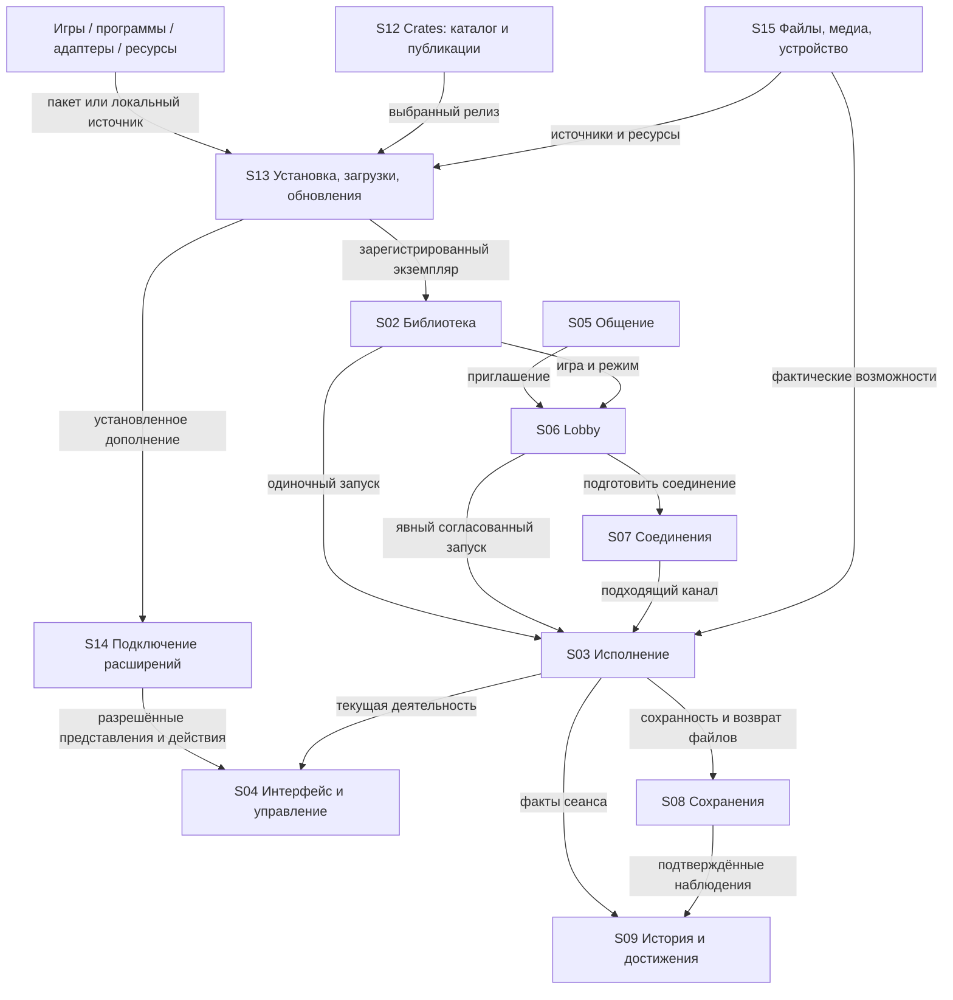
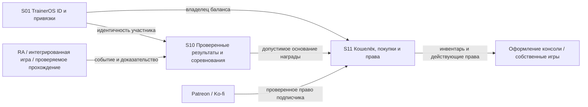

# Структура TrainerOS: владельцы, контракты и связи

**21 октября 2026. Первая рабочая карта согласованной конечной структуры.**
TrainerOS — консольная экосистема с общими правилами, сервисами и точками подключения.
Часть функций принадлежит самой консоли; игры, программы и адаптеры используют их.
Карта описывает владельцев и зависимости, а не глобальную очередь разработки.

Для каждой функции прослеживается цепочка:
**владелец → вход/выход → зависимости и потребители → жизненный цикл → код → готовность**.
ID `S01–S15` обозначают логическую ответственность, а не новые процессы, классы
или микросервисы. `E01–E19` — связи между владельцами. Имена полей ниже обозначают
смысл данных, не объявляют готовый публичный SDK или новую схему БД.

- [Готовность функций](FEATURE_READINESS.md) — фактические результаты и остаток;
  у каждой строки указан основной владелец и затрагиваемые узлы этой карты.
- [Продуктовый контракт](PRODUCT_ARCHITECTURE_RU.md) — принципы и согласованный объём.
- [Экранные решения](PRODUCT_SPEC.md) — где пользователь видит функции.
- [Техническая архитектура](ARCHITECTURE.md) — существующие механизмы.

## 1. Общая схема

Стрелки показывают подписанные обращения/события, а не передачу владения данными.
Профиль S01 задаёт контекст владельца для личных операций во всех узлах.
S04 представляет функции; расположение экрана не делает его владельцем их данных.

Экономический контур связан с играми, но имеет собственную проверку событий:

## 2. Владельцы функций и состояния

| ID / система | Единолично отвечает за | Принимает → предоставляет | Граница ответственности |
| --- | --- | --- | --- |
| **S01 Игрок и идентичность** | Локальный Trainer, выбор владельца, привязки; целевой TrainerOS ID и восстановление доступа | Вход/смена профиля → контекст владельца и допустимый доступ | Локальный Trainer работает офлайн. Fluxer ID не равен TrainerOS ID; баланс хранит S11. |
| **S02 Библиотека** | Идентичность игры/программы, экземпляры, коллекции, избранное, связи с runtime | Импорт/установка/каталог → карточка, выбор экземпляра, доступные действия | Название и коллекция не дают совместимость, права на save или multiplayer. Исторические идентификаторы сохраняются. |
| **S03 Исполнение** | Реальная деятельность, процесс/сеанс, подготовка runtime, возврат и завершение | Запрос запуска с owner/game/runtime → подтверждённый сеанс и его исход | Геймплей и синхронизация остаются игре/runtime. Выбранная карточка не подменяет запущенную игру. |
| **S04 Оболочка и управление** | Пять разделов, маршруты, системные кнопки, фокус, клавиатура, Home/Start, уведомления | Состояние сервисов/разрешённые UI-вклады → отображение и семантические действия | Экран не становится второй БД профиля, комнаты или пакетов. Ввод игры принадлежит действующему сеансу. |
| **S05 Общение** | Интеграция друзей, сообщений, сообществ, вызовов, presence и медиа провайдера | Пользовательские действия/Fluxer events → переписка, звонок, приглашение | Fluxer остаётся источником своих членств/прав. Звонок и переписка не принадлежат игровому процессу. |
| **S06 Lobby и совместные занятия** | Комната, состав, выбор занятия, места, Ready, допуск и повторный вход | Приглашение/выбор/готовность → подготовка и явный Start хозяина | Комната существует между играми. Единый обычный multiplayer вход; специфический семантический Link остаётся действием адаптера. |
| **S07 Соединения** | Подготовка поддерживаемого канала, endpoint/session binding, состояние соединения | Согласованный режим/участники → канал для runtime или приложения | Использует готовые netplay/P2P/native services. Не реализует универсальную игровую симуляцию. Fluxer media не считается произвольным relay. |
| **S08 Сохранения и целостность** | Привязки личных saves, backup/restore, protected-write/recovery, lineage | Сеанс или точная разрешённая операция → сохранённые файлы и проверенный результат | Обычные saves принадлежат пользователю/игре. Семантическую операцию знает адаптер; допуск и commit контролирует host. |
| **S09 История и достижения** | Факты игры, My Story/Timeline/Gallery, проекции прогресса и достижений с источниками | События сеанса, RA, проверенные наблюдения → личная история и представления | Пользовательская запись и импортированный прогресс не являются доказанной денежной наградой. |
| **S10 Проверенные результаты и соревнования** | Целевые правила приёма событий, повторов/аннулирования, зачётов/рейтингов/турниров | Событие с доказательством и идентичностью → подтверждённый результат/основание награды | Формулы, Arcade Today, кланы и части верификации ещё требуют решения. Наличие lineage не означает готового античита. |
| **S11 Экономика и права** | Серверный баланс/журнал, покупки, инвентарь, правила начисления и преимущества подписки | Основание награды/покупка/проверенная подписка → подтверждённая операция и права | Клиент не назначает баланс. Магазин открыт всем, множитель до ×3, приобретения сохраняются; без pay-to-win/прямой продажи монет. Тарифы не определены. |
| **S12 Crates и публикации** | Курируемый каталог, проекты/релизы, размещение, сведения об авторах, reviews/Top Rated | Одобренная публикация, каталог, допустимый отзыв → предложение установки и сведения о проекте | Установленные файлы принадлежат учёту S13. Донат автору не равен подписке TrainerOS. Reviews используют существующий Fluxer механизм. |
| **S13 Доставка и обслуживание** | Задания загрузки/установки, версии/зависимости/целостность, активные пакеты, update/remove/recovery | Выбранный источник/версия/операция → результат задания и изменение inventory | Crates — один источник. Image/host, TrainerOS Software, игры и пользовательские данные имеют разных владельцев обновления. |
| **S14 Расширения и контракты** | Совместимость, регистрация, доступ к существующим сервисам и разрешённым UI-точкам, отключение | Manifest/descriptor/контекст → действующие возможности и вклады пакета | Адаптер, runtime-интеграция и SDK-приложение — разные роли. Публичные SDK/#92/SPI ещё не готовы; built-in API не объявляется внешним ABI. |
| **S15 Среда устройства** | Общие файловые/медиа/аппаратные службы: места хранения, звук, питание, сеть устройства, диагностика | Фактические host capabilities/запросы → доступные операции и состояние | Использует Armada/Linux. Не выдумывает поддержку устройства и не делает Desktop Mode обязательным для обычных действий. |

Пользовательские материалы отделены от заменяемого кода. Системы S01/S10/S11 могут
иметь серверные части; это не делает обычный запуск зависимым от backend.
Собственные игры используют те же границы. Эксклюзивная интеграция означает
зависимость от реально используемых возможностей платформы, без искусственного DRM.

## 3. Реестр связей и передаваемый контекст

При изменении узла проверять затронутые входящие **и** исходящие связи. Потребитель
обрабатывает отсутствие/отказ сервиса; success означает подтверждённый результат.

| Связь | Откуда → куда | Смысл контракта | Завершение / защита от неверного контекста |
| --- | --- | --- | --- |
| **E01** | S01 → остальные S | owner, привязанный account, актуальность контекста | Смена Trainer отменяет устаревшие callbacks; чужие данные/токены/права не переносятся. Политика смены при живом сеансе требует явного допуска. |
| **E02** | S12 или локальный источник → S13 | Намеренная установка: project/package, version, source, compatibility | Открытие каталога не запускает Download/Update. Отмена не создаёт установленный пакет. |
| **E03** | S13 → S02/S14 | Успешная активация: installation, version, roles, owned paths | Карточки/вклады регистрируются по факту; ошибка обновления сохраняет пригодную версию и личные данные. |
| **E04** | S02/S06 → S03 | owner, игра/экземпляр, runtime/mode, return context; при multiplayer — session/seat | Проверка готовности перед запуском; выбранная игра и запущенная игра имеют независимую идентичность. |
| **E05** | S03 ↔ S04/S15 | session/process, foreground/input ownership, Home/return/exit | Потеря процесса освобождает ввод. Home/Minimize не объявляют pause/save. |
| **E06** | S05 → S06 | Приглашение/намеренный Join с комнатой, actor и условиями доступа | Presence не запускает игру. Отказ/истечение приглашения не меняет голос или save. |
| **E07** | S06 → S07/S03 | Состав/места, подтверждённый режим, runtime/content compatibility, состояние подготовки | Ready разрешает отдельный Start хозяина. Потеря связи/rejoin повторно проверяет допуск; не восстанавливает место по одному старому кешу. |
| **E08** | S03 ↔ S08 | owner/game/build/session, runtime save paths, наблюдаемый исход | Пока игра владеет save, внешняя семантическая запись запрещена. Краш не считается успешным сохранением. |
| **E09** | Адаптер через S14 → S08 | Точная операция, build/source revision, owner, входные данные | Backup → разрешённая запись → readback/recovery. Presentation match не даёт write capability. |
| **E10** | S03/S08/RA → S09 | Факт, источник, owner/game/session, время/достоверность | Проекция сохраняет unknown; историческое событие не выдаётся за новую проверку. |
| **E11** | Игра/RA/проверяемое прохождение → S10 | Идентичность события/участников, результат и поддерживаемое доказательство | Повторы, конфликт и неподтверждённое событие не превращаются в победу/награду. Точные политики ещё открыты. |
| **E12** | S10 → S11 | Принятое основание начисления, rule/version, уникальность операции | S11 рассчитывает и фиксирует начисление один раз; порядок исправлений/возвратов требует определения. |
| **E13** | Patreon/Ko-fi + S01 → S11 | Проверенная привязка и действующее право поддержки | Отмена прекращает временные преимущества; покупки/остаток не удаляются. Локального флажка недостаточно. |
| **E14** | S11 → S04/игра | Инвентарь и права на конкретное оформление/предмет | Каждый потребитель применяет совместимые предметы. Общий баланс не означает совместимость каждого предмета со всеми играми. |
| **E15** | Дополнение → S14 → S04/сервисы | Роль, совместимость, именованный вклад, owner/game/session context | Disable/update/remove снимают вклад и stale actions; fallback сохраняет игру и личные данные. |
| **E16** | Files/Browser/PC/ScreenScraper → S13/S15 | Источник, назначение, операция, progress/cancel/result | Общие задания и сохранность назначения; закрытие страницы не означает отмену работы. Полное объединение существующих путей проверяется отдельно. |
| **E17** | S09/S13 → S12 | Доказательства eligibility отзыва: допустимая игра/установка/активность | S12 применяет свой review contract; косметическая валюта не является правом оставить отзыв. |
| **E18** | S06 ↔ S05/S07 | Зритель/игрок, разрешения на media/input, текущий поток/место | Spectator через Fluxer и interactive Remote Play через P2P различны; смена роли требует нового допуска. |
| **E19** | S06/S07/S13 ↔ S08/S03 | Guest-content lease, content identity, временное размещение и допустимый сеанс | Временный контент не регистрируется как постоянная собственная игра; конец lease/сбой имеет отдельную очистку и сохраняет личные saves по принятой политике. |

## 4. Подключаемое содержимое: вход, работа, выход

Один пакет может совмещать роли. Для обычной Linux-программы не обязательны SDK,
Crates, особый аккаунт или отдельный сервер. Сервисы подключаются по потребности.

| Роль | Вход | Что принадлежит содержимому | Точка выхода и сохраняемое состояние |
| --- | --- | --- | --- |
| Игра / программа | S13 установка или S02 регистрация существующего экземпляра; запуск S03 | Геймплей/документ/уникальная логика, собственные пользовательские данные | Завершение процесса/деятельности, возврат и освобождение ресурсов; профиль/история остаются. |
| Runtime-интеграция | Обнаружение совместимого runtime и режима; запрос S03 | Конфигурация исполнения, команды запуска, особенности ввода/save/netplay | Остановка helpers, освобождение ввода и временной конфигурации; результат обратно S03/S08. |
| Experience-адаптер | S14 manifest match точной игры; выбранный owner/game context | Семантика игры, представления/действия, внутренняя навигация, schema своих материалов | leave/context change/disable: stale callbacks отменяются, host использует fallback. Семантические транзакции завершаются через S08. |
| Виджет / игровой инструмент | Разрешённая UI-точка S14/S04, при необходимости живой session context | Собственное компактное представление/действие | Снятие вкладов/подписок; нет оставшихся кнопок, захвата ввода или действия против другой игры. |
| File/media/service provider | Подключение к соответствующему сервису S15/S13 через контракт S14 | Доступ к своему источнику/специальной операции | Отключение источника с явным результатом заданий; независимые локальные данные остаются. |
| Оформление / asset pack | Установка S13, выбор совместимым потребителем | Ресурсы и schema/entity mapping своего семейства | Возврат к доступному набору; пользовательский pack хранится отдельно от обновляемого кода. |

**UI-точки подключения:** Home — вклад текущего Experience; GameHub — именованные
экраны Adapter; Start — согласованные виджеты; Game Options/HUD — session-bound
инструменты; Files/Media — источники через соответствующий сервис. Host сохраняет
пять основных разделов, navigation/input правила и обычные Overview/RA/Lobby.
Built-in Experience реализован; внешние SPI/SDK-вклады требуют своих контрактов.

## 5. Независимые сущности и жизненные циклы

| Различать | Правило связи |
| --- | --- |
| Local Trainer / TrainerOS ID / Fluxer account | Привязки, а не один общий идентификатор. Онлайн recovery и перепривязка ещё проектируются. |
| Игра / издание-build / экземпляр / личное прохождение | Общая карточка не разрешает смешивать saves или сетевые версии. Физическое хранение и миграции следуют действующей модели, не этой схеме автоматически. |
| Package/project / installation / library entry | Пакет может дать несколько ролей; карточка может ссылаться на уже установленное ПО вне Crates. |
| Выбранная игра / live session / процесс / foreground owner | Каждое действие привязано к нужной сущности и её актуальному поколению. |
| Комната / игровой раунд / conversation / call / transport connection | Конец игры не завершает комнату или звонок; потеря канала не означает добровольный выход участника. |
| Личная история / доказательство / принятое событие / начисление | История может существовать без права на проверенную награду; начисление принадлежит S11. |
| Подписка / купленная косметика / установленный пакет | Срок действия преимуществ не удаляет покупки и локальные программы. |

| Событие | Что обязано завершиться или измениться | Что сохраняется / отдельное условие |
| --- | --- | --- |
| Обычный Exit / crash игры | S03 фиксирует реальный исход, освобождает session-bound ввод/вклады; S08 различает успешный возврат и recovery | Профиль, комната, разговор; crash не создаёт фиктивный save/результат. |
| Смена игры в комнате | Новый выбор/места/readiness и проверки E07 | Членство комнаты и независимый call; нельзя без проверки переносить старый допуск. |
| Отключение/обновление адаптера | Старые вклады и callbacks больше не действуют; активная save-транзакция учитывается | Игра, обычные saves/история; generic fallback. |
| Update/remove пакета | Замена только принадлежащих пакету файлов, снятие регистрации по ролям, обработка busy use | Личные данные отдельно; удаление данных требует отдельного намерения. |
| Потеря provider/backend | Явная недоступность зависимых операций, ограниченный reconnect/retry | Обычный локальный запуск; экономический кеш не разрешает самовольные покупки. |
| Смена профиля / сон / перезапуск | Переоценка owner/session/input/network context | Нельзя считать старую комнату, save lease или доступ действующим без восстановления. Физическая приёмка сна открыта. |

## 6. Привязка к текущей реализации

Пути проверены в рабочей ветке `codex/apps-workspace`. **Есть код** означает
существование механизма, не полную готовность узла. PC/LAN/input/runtime содержат
отдельный незакоммиченный WIP; аппаратные результаты смотреть по сборке/дате.

| Узел | Существующая опора | Что ещё не является завершённым контрактом |
| --- | --- | --- |
| S01 | [TrainerController](../src/features/trainer/TrainerController.h), [TrainerRepository](../src/core/repository/TrainerRepository.h), [ownership](TRAINER_OWNERSHIP.md) | TrainerOS ID, recovery и online-привязки — [target](TRAINEROS_ACCOUNT_ECONOMY_RU.md). |
| S02 | [LibraryRepository](../src/core/repository/LibraryRepository.h), [SqliteLibrary](../src/core/storage/SqliteLibrary.h), [PC import](../src/features/pc/PcGamesController.h) | Общая совместимость всех изданий/форматов и автоматические коллекции не закрыты. |
| S03 | [Launch](../src/core/navigation/AdventureLaunchController.h), [Exit](../src/core/navigation/AdventureExitController.h), [runtime integrations](../src/integrations/adventure) | Общий цикл всех игр/программ, PC installer/runtime и часть multiplayer остаются открыты. |
| S04 | [ShellController](../src/core/navigation/ShellController.h), [input](../src/platform/input), [контракт](CONTROLS78_HOME_START.md) | Все физические контроллеры/TV, Home во всех runtime и внешний contribution API не приняты. |
| S05 | [SocialController](../src/features/social/SocialController.h), [FluxerSession](../src/integrations/social/FluxerSession.h), [SocialMedia](../src/features/social/SocialMedia.h) | Реальная речь/гарнитура и отдельные provider/lifecycle сценарии открыты. |
| S06 | [LobbyCoordinator](../src/features/social/LobbyCoordinator.h), [LobbyRuntime](../src/features/social/LobbyRuntime.h), [directory bot](../services/lobby-directory/README.md) | Offline Lobby, полный rejoin/роль зрителя/все runtime не готовы. Физическое размещение в Social не меняет владельца комнаты. |
| S07 | [network](../src/platform/network), [OnlineLink](../src/integrations/social/OnlineLink.h), [remote-play transport](../tools/remote-play-stream/transport), [матрица](EMULATOR_MULTIPLAYER_MATRIX.md) | Общий Network Fabric SDK — target; разные сети/режимы и PC LAN WIP имеют отдельные границы. |
| S08 | [RuntimeSaveStorage](../src/platform/storage/RuntimeSaveStorage.h), [SaveBackupStorage](../src/platform/storage/SaveBackupStorage.h), [SaveLineage](../src/platform/storage/SaveLineage.h), [реестр адаптеров](adapters/README.md) | Все форматы/миграции, MP-02 и portable Trainer backup не приняты. |
| S09 | [SqlitePlayHistory](../src/core/storage/SqlitePlayHistory.cpp), [achievement integrations](../src/integrations/achievements), [RA](RA73_GAME_SELECTION.md) | Полный live unlock/history/media цикл не закрыт; общей экономической верификации здесь нет. |
| S10 | [Target соревнований](TRAINEROS_BACKEND_PLAN_RU.md), [правила доверия](TRAINEROS_ACCOUNT_ECONOMY_RU.md) | Готового общего сервиса матчей/турниров/наград не заявлено; правила и API открыты. |
| S11 | [Согласованная экономика](TRAINEROS_ACCOUNT_ECONOMY_RU.md) | Кошелёк, подписочные права и магазин — target, не установленный backend. |
| S12 | [CratesCatalogue](../src/features/crates/CratesCatalogue.h), [CratesController](../src/features/crates/CratesController.h), [FluxerReviews](../src/integrations/social/FluxerReviews.cpp), [поставка](CRATES77_CATALOGUE.md) | Полные reviews/Top Rated, публикации и donation UX не закрыты. |
| S13 | [CratesInstaller](../src/features/crates/CratesInstaller.h), [DownloadsController](../src/features/downloads/DownloadsController.h), [FilesService](../src/platform/files/FilesService.h), [PC](../packaging/pc/README.md) | Есть разные существующие исполнители; полная унификация jobs, software updater и installer/recovery не объявляются готовыми. |
| S14 | [ExperienceModule](../src/core/experience/ExperienceModule.h), [manifest](../src/core/experience/ExperienceManifest.h), [composition](../src/adapters/BuiltinExperiences.cpp), [правила](../src/adapters/AGENTS.md) | Trusted built-ins существуют; #92, SPI и Platform SDK #235–244 остаются отдельными незавершёнными контрактами. |
| S15 | [PlatformService](../src/platform/PlatformService.h), [device](../src/platform/device), [FilesService](../src/platform/files/FilesService.h), [power](../src/platform/power), [Apps](../src/features/apps/AppsController.h), [Browser](../src/features/browser/BrowserController.h) | Микшер, сон/recovery, providers и все host/device profiles не завершены. Apps/Browser — потребители общих служб, не отдельные владельцы профиля. |

## 7. Внешние системы и пределы их роли

| Внешняя сторона | Связь с TrainerOS | Что остаётся у консоли / игрока |
| --- | --- | --- |
| Fluxer | S05 сообщения/друзья/звонки, S06 signaling/directory, внешний вход S01 | Собственный TrainerOS ID, библиотека, saves, wallet. Доступные операции проверяются по provider API. |
| RetroAchievements | S09 достижения, источник допустимых доказательств S10 | Правила платформенных наград и денежный журнал S11. |
| Patreon / Ko-fi | Подтверждение поддержки для S11 | Свои права/инвентарь и их жизненный цикл; политика начислений определяется TrainerOS. |
| GitHub Releases / каталог Crates | Артефакты и опубликованные метаданные S12/S13 | Явное решение об установке и локальное inventory; VPS не становится зеркалом игровых архивов. |
| Steam / эмуляторы / Wine-Proton-FEX | Источник/исполнение через S02/S03 и поддержку версий S13 | Единый контекст запуска и возврата. Существующие пользовательские установки/сейвы сохраняются. |
| Linux / Armada и другие поддержанные hosts | S15 реальные файлы, устройства, процессы и capabilities | Консольный UX/общие функции; host updater не подменяется обновлением игры. |
| Backend TrainerOS | Целевые серверные части S01/S10/S11, метаданные S12 и directory | Обычные локальные игры работают независимо; тяжёлый owner-hosted media relay не становится обязательным. |

## 8. Открытые структурные вопросы

Это пробелы контрактов с указанными владельцами, без очереди исполнения:

| Владелец / связь | Что определить или проверить |
| --- | --- |
| S01 / E01,E13 | Перепривязка/recovery TrainerOS ID, несколько устройств, смена профиля при живой деятельности. |
| S02/S03/S07 / E04,E07 | Правила совместимости изданий для каждого режима. UI identity, точный save-build и сетевой допуск имеют разные условия; единый EXE hash нельзя автоматически переносить на все игры. |
| S10/S11 / E11–E14 | Допустимые события, правила наград/отмены/повторов, офлайн-события, тарифы и цены; обмен валютой/вывод/торговля не утверждены. |
| S10 | Правила Arcade Today, турниров, кланов и трофеев: критерии участия/результата/спора. |
| S12/S13 / E02,E03,E16 | Разделение каталога, исполнителей install jobs и inventory; исключить параллельные владельцы одного задания, не переписывая рабочие механизмы без причины. |
| S14 / E15 | Версии service/contribution контрактов, установка внешних адаптеров/SPI, отзыв/изоляция вкладов и миграции данных. Текущий C++ built-in интерфейс не равен публичному SDK. |
| S06/S07 / E07,E18 | Rejoin/смена ролей/поздний вход; прямое соединение между сетями и честный результат при неподдерживаемой сети. |
| S06/S08/S13 / E19 | Полная guest lease/policy/cleanup цепочка при сбое без потери собственного прогресса. |
| S03/S04/S15 / E05 | Единое освобождение ввода/оверлеев при завершении, смене foreground, сне и восстановлении. |

## 9. Использование при изменениях

1. Найти основной S-узел функции в [таблице готовности](FEATURE_READINESS.md).
2. Назвать меняемый вход/выход и связанные E-контракты. Проверить их потребителей,
   исходя из фактического изменения, а не запускать все проверки проекта.
3. Сверить существующего владельца в коде. Для нового функционала расширять
   подходящий механизм; новый узел нужен только при новой ответственности.
4. При изменении роли/данных/контракта обновить эту карту и профильную спецификацию.
   При изменении реализации/проверок обновить готовность и доказательство сборки.
5. Проверить обычный вход, завершение/отказ и сохранность независимых состояний
   для затронутой связи. Недоступное внешнее условие оставить явно непроверенным.

Карта фиксирует связь, а не обещание полной готовности. Портативки у владельца;
создание этой карты не включает подключения, изменения устройств или runtime-кода.
