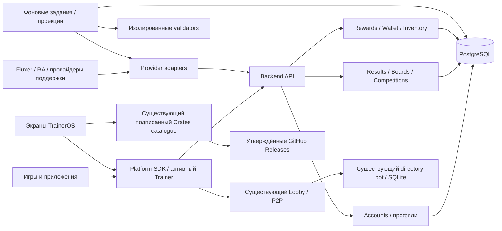

# TrainerOS Backend — обязанности и границы серверных функций

**25 октября — первый реальный игровой потребитель подключён.** Pocket Golf
использует общий SDK для полных индивидуальных/командных раундов, результатов и
таблиц. Неизменные правила острова зарегистрированы; SDK/Golf остаются
подготовленными сборками. [Приёмка и ограничения](evidence/backend-golf-20261025/README.md).
Это уточняет прежнее «Golf integration открыта» ниже; stronger validation,
публичный игровой профиль, рейтинг/экономика и аппаратная приёмка не закрыты.

**25 октября — сквозной scorecard preview.** Реализована цепочка SDK → host grant →
серверный матч → заявки → worker → общие records/wins/statistics. [Контракт](../sdk/PLAY.md),
[сервер](../services/backend/play.md), [приёмка](evidence/backend-play-20261025/README.md).
Доверие — подтверждение всех участников, не серверное воспроизведение физики.
Эта поставка закрывает соответствующую часть ранее проектной архитектуры;
конкретные production game rules, Golf integration, stronger validation, статус/Elo,
турниры, экономика и эксплуатационные условия остаются открытыми.

**Accounts, позднее 25 октября:** [серверный модуль](../services/backend/accounts.md)
реализован и установлен. Отдельное приложение TrainerOS в постоянном аккаунте
владельца и публичный HTTPS origin созданы, secret/callback настроены, provider login включён.
Живые consent/cancel/relogin, refresh и отзыв прошли. Native return без кода,
host session и ограниченный SDK identity теперь реализованы; приёмка системного
хранилища/возврата окна на портативках остаётся отдельно. Вход только через
Fluxer, без второго username/password. Ниже прежние утверждения «учётные записи
не реализованы» относятся к состоянию до этого прохода; полные SDK grants/recovery
и остальные продуктовые модули всё ещё не завершены.

**Обновление 25 октября: серверный каркас реализован.** Владелец уточнил:
«На серваке сразу делай. Не разводи мусор на рабочем компе». Это отменяет прежний
запрет на серверную установку Backend в этом чате. [Реализация и эксплуатация](../services/backend/README.md)
и [серверная приёмка](evidence/backend-foundation-20261025/README.md) описывают
действующий infrastructure foundation. Последующие разделы архитектуры и formal
contracts остаются проектом продуктовых модулей: учётные записи/результаты/экономика
ещё не реализованы, а capabilities не обещает их доступность. Серверные проверки
не заменяют приёмку SDK, игр, провайдеров и портативок.

> Решения 19–20 октября; сверка 21 октября 2026. Это спецификация функций, **не глобальный план и не распоряжение арендовать VPS**. Очередь и категория «позднее» сняты. Directory bot и Crates catalogue имеют существующие реализации; account/competition/economy остаются отдельными незавершёнными требованиями. [Готовность R089/R107–R115](FEATURE_READINESS.md#r089), [структура](STRUCTURE_MAP_RU.md#f05).

**25 октября — подготовка общей серверной системы по запросу владельца.**
В [проекте основания](#foundation-20261025) конкретизированы границы модулей,
идентичность, результаты, SDK и первый сквозной сценарий с гольфом. Это проект
для реализации, а не работающий API; исходники сервиса, deploy и приёмка ещё
предстоят. Общего плана для остальных функций TrainerOS этот раздел не вводит.

**Уточнение владельца, 25 октября:** сначала подготовить **всю архитектуру
серверной системы**, затем реализовывать и полировать рабочие сценарии.
[Архитектура v1](#architecture-v1) охватывает все модули, данные, контракты,
отказы и эксплуатацию. Предыдущее предложение сразу начать с вертикального
сценария гольфа снято; гольф остаётся проверочным примером проекта.

**Формальные контракты, 25 октября:** подготовлен [пакет architecture-draft.2](../services/backend/contracts/README.md)
для всех 13 модулей: OpenAPI (67 операций), 122 JSON Schema, 48 логических
сущностей, 12 событий, 14 предложенных SDK-методов и gates включения функций.
Генератор/валидаторы проверяют согласованность проекта и 36 граничных примеров.
Это не работающий Backend: SQL migrations, API handlers, OAuth и эксплуатация
ещё не реализованы. Текущий SDK и протоколы Lobby/аватара не изменены.

## 1. Зачем сервер

Нужна **одна компактная серверная инфраструктура TrainerOS** для координации, метаданных и проверенных результатов. Её используют TrainerOS и Crates, но она **не становится обязательной основой запуска игр** и не заменяет Fluxer, P2P или операционную систему.

Основные принципы:
- **Клиенты исполняют игры**, а Backend учитывает события и публикует согласованные результаты.
- **Fluxer** остаётся владельцем общения, друзей, сообществ, ролей, присутствия и поддерживаемых приглашений; не создавать собственную копию социальной сети.
- **GameHub Lobby** остаётся единственным универсальным игровым лобби (#179/#216); не создавать второе лобби на Backend.
- Для LAN и подходящих прямых P2P-сессий сервер **не обязателен** и не проксирует каждый игровой пакет. Возможности передачи данных через публичный Fluxer исследуются в #105; наличие голоса/видео не является доказательством наличия разрешённого game-data relay.
- **Crates** хранит небольшие метаданные на нашем сервере, а исполняемые пакеты и крупные архивы забираются непосредственно с утверждённых GitHub Releases (#144/#146/#147).
- Если Backend недоступен, локальные игры, существующие сохранения, доступные P2P-соединения и установленное ПО работают дальше. Глобальные рейтинги и обновления серверного каталога могут временно быть недоступны.

## 2. Логические службы на одном VPS

| Подсистема | Назначение | Состояние |
| --- | --- | --- |
| **Fluxer bot / lobby directory** | Объявления публичных комнат, их обновление и закрытие, связь с комьюнити | **Уже есть** Python-бот и SQLite в `services/lobby-directory/`; сохраняем существующего владельца и протокол |
| **Crates catalog API** | Версионированные манифесты, курсор/ETag, изменения, совместимость, ссылки на релизы и проверки пакетов | **Частично реализовано:** [подписанный каталог/публикация](CRATES77_CATALOGUE.md); полный #144–152, авторский onboarding/внешние пакеты/отзывы не закрыты |
| **TrainerOS Account / Player identity & API** | Постоянный серверный TrainerOS ID, безопасная привязка Fluxer/RA/Patreon/Ko-fi, сессии API и права онлайн-аккаунта | **Не сделано**; согласованный target, безопасная перепривязка и recovery требуют проекта/реализации |
| **Competition / match results** | История матчей, победы/поражения, уникальные побеждённые соперники, общие и контекстные рейтинги | **Концепция Crates**, точная проверка матчей и формула статуса открыты |
| **Arcade Today** | Событие дня, условия состязания, итоги, лидеры и архив победителей | **Концепция**, критерии призов и периодичности открыты |
| **Tournaments** | Зачёты и сетки соревнований, подтверждённые результаты | **Не сделано** |
| **Clans** | Соревнования между Fluxer-сообществами с поддержкой мини-игр | **Не сделано**, членство и формат зачёта ещё не утверждены |
| **Wallet / cosmetics / subscription entitlements** | Единый журнал начислений/трат, подтверждённые награды, покупки, инвентарь, множители заработка и права на закрытые сборки | **Согласованный TARGET**; экономика/проверка провайдеров/API ещё открыты |
| **Competition trophies & rewards** | История трофеев, отображаемая корона чемпиона, связь с проверенными игровыми событиями | **Не сделано**; критерии призов ещё не утверждены |
| **Ghost/Challenge metadata** | Ограниченные результаты вызовов и ссылки на записи гонок, если понадобятся | **Опционально**, не резервируем большое файловое хранилище |
| **Operations** | Резервные копии, мониторинг, лимиты, журналы ошибок, восстановление | **Требуется при фактическом развёртывании** |

Это **модули одного Backend, а не отдельные обязательные машины или самостоятельные серверы под каждую игру**. По мере роста допускается разделить сервисы.

## 3. Границы данных и событий

Пример матча:

1. Игроки входят в **существующее** TrainerOS GameHub Lobby, играют на своих устройствах.
2. По завершении игра формирует небольшой результат: версия формата, `game_id`, `match_id`, ID и исход каждого участника, при необходимости `community_id` и `tournament_id`.
3. Backend принимает сообщение **только от проверенного участника/клиента по разрешённому маршруту**, проверяет принадлежность к сессии, уникальность операции и правила конкретной игры. Одна заявленная победа сама по себе **не является доказательством**.
4. Подтверждённое событие записывается идемпотентно. Производные счётчики и таблицы пересчитываются / обновляются без двойного начисления.
5. При наличии утверждённых турниров, соревнований дня или клановых встреч эти подсистемы получают **тот же результат**, а не требуют отдельной отправки от игры.
6. Только после подтверждения начисляется награда; бот при необходимости публикует ограниченное объявление через Fluxer.

**Согласованный принцип статистики из Crates:** учитывать **все матчи, все победы, все поражения и количество уникальных игроков, когда-либо побеждённых пользователем**; повторная победа учитывается в победах, но не добавляет нового уникального соперника. Поражение понижает статус, победа повышает; конкретная формула статуса пока **не выбрана**. Историю реваншей не стирать.

При отсутствии проверки одиночного рекорда сервер **не должен** называть его достоверным. Согласование обоих участников может быть начальным вариантом для матчей между игроками, но не защищает от сговора; единого античита на всю платформу не обещаем.

Таблицы данных по смыслу: `players` (собственный стабильный TrainerOS ID и проверенные привязки внешних аккаунтов), `games`, `match_events`, `participants`, `rating_projections`, `communities`, `competitions`, `tournaments`, `rewards`, `wallet_ledger`, `cosmetic_entitlements`, `membership_grants`, `catalog_revisions` и `catalog_items`. Это **эскиз сущностей, не утверждённая схема БД**.

## 4. TrainerOS ID, Fluxer и общая экономика

**Каноническая новая концепция:** [TrainerOS Account / общая экономика / собственные эксклюзивы](TRAINEROS_ACCOUNT_ECONOMY_RU.md) (решение 20 октября 2026).

- **Fluxer достаточен как внешний способ входа; отдельная форма регистрации с новым паролем TrainerOS не нужна.** Но Backend владеет **собственным постоянным TrainerOS ID**, независимым от Fluxer ID, для баланса, купленной косметики и прав подписчика. Безопасная привязка/отвязка/восстановление требуют проекта и проверок.
- **Локальный Trainer остаётся офлайн-профилем** и связывается с онлайн TrainerOS ID по выбору; нельзя смешивать данные разных локальных пользователей или требовать облачный вход для обычного запуска игр.
- **RA** — источник подходящих подтверждённых достижений; **Patreon/Ko-fi** — подтверждённых прав подписчика и множителя монет до ×3; Provider ID или локальный флажок подписки не равен проверенному платёжному событию.
- **Магазин косметики открыт всем**. Backend — авторитетный журнал начислений, трат и постоянного инвентаря; все награды идемпотентны. Подписка даёт модификатор заработка, а не блокирует магазин, не выдаёт фиксированную месячную пачку монет и не даёт скидок. Более высокие уровни могут давать ранние dev/beta-сборки. Числа и правила вынесены в отдельное исследование.
- Передачу `user_id` в теле запроса нельзя считать аутентификацией. Backend проверяет авторизацию через действительно поддерживаемый Fluxer/OAuth-механизм и выдаёт узкие ограниченные разрешения на нужную операцию.
- Бот живёт со своими минимальными полномочиями; роли администраторов сообществ и пользовательские токены не копируются в клиентские пакеты.
- В данных Backend нет содержимого личных сообщений, ключей/токенов, списков ROM, сохранений, IP-адресов без доказанной необходимости, видео или голосовых файлов.
- Записи матчей имеют уникальные ID, защиту от повторной подачи, ограничения размера и частоты запросов, версионирование и журнал исправлений/аннулирований.

**Рейтинги отзывов Crates:** не вводить вторую независимую систему отзывов вместо действующего Fluxer Reviews (#113/#151). При необходимости допустима производная публичная проекция/кеш.

## 5. Crates: что держим на сервере

Подробная политика и безопасные рецепты — в [CRATES_SERVER_STORAGE_RU](CRATES_SERVER_STORAGE_RU.md).

Разрешены небольшие:
- Каталог проектов, карточки, категории, авторство, изображения в ограниченном размере, ссылки, версия и статус.
- Ревизии и delta-feed для открытого пользователем каталога, поддерживаемые платформы, зависимости, точные хеши/подписи релизов.
- **Декларативные рецепты установки**, профили совместимости, наборы разрешённых конфигурационных файлов, небольшие данные для адаптеров.
- Ссылки на утверждённые GitHub Releases, откуда и скачиваются сами пакеты.

**Нельзя** превращать VPS в зеркало бинарников/ROM, запускать полученный по сети произвольный `.sh` с повышенными правами, подменять безопасный штатный установщик или включать автообновление только из-за изменения каталога. Для действительно специальных скриптов нужен **проверенный версионированный пакет** с разрешёнными действиями и правами, а не удалённый исполняемый текст.

**Ранее согласовано:** каталог синхронизируется **один раз при открытии Crates**, используя локальный кеш и cursor/ETag; клиент не опрашивает GitHub по расписанию и не ставит обновления автоматически. Публикация релиза уже принятого проекта обновляет его сведения через контролируемый издательский процесс.

## 6. Предлагаемая эксплуатация, без преждевременного переписывания

Первый разумный стек:
- Linux VPS (Debian/Ubuntu), **HTTPS** и небольшой reverse proxy (например, Caddy).
- Сохранить уже работающий **Python 3.12 / SQLite lobby-directory bot** до доказанной необходимости миграции.
- Небольшой API (кандидат: **Python/FastAPI**) и фоновые задания для итогов/публикаций; не обязательны отдельные микросервисы.
- Для новой общей многопользовательской БД **PostgreSQL как кандидат**, с явной миграцией и тестами. Не переписывать существующую SQLite без причины.
- Процессы под `systemd` либо ограниченный Docker Compose; минимальный набор портов, непривилегированные пользователи, секреты только в серверной конфигурации.
- Автоматические **внешние** резервные копии БД и конфигурации, тесты восстановления, мониторинг диска/CPU/RAM, метрики ошибок и очередей, ротация журналов без секретов.
- Отдельный путь публикации конфигурации/каталога с атомарной сменой ревизии и откатом. Операции администратора не доступны обычным игрокам.

Подразделы одной системы должны масштабироваться независимо по нагрузке; не связывать завершение игровых сессий с рестартом бота или API.

## 7. Размер VPS и масштабирование

Обсуждались начальные **VPS с 4 vCPU / 8 ГБ RAM / примерно 80 ГБ SSD** и более свободный вариант **8 vCPU / 16 ГБ / примерно 160 ГБ SSD**, с ориентиром на бюджет около **€10–20/мес.** Это **примеры, не выбор тарифа и не фиксированная цена**; текущие цены, регион, IVA/НДС, IPv4, backups и трафик проверяются при заказе.

- 80–160 ГБ достаточно для начала каталога, небольших статических конфигураций и умеренной БД **при отсутствии зеркала установочных архивов, стриминга и пользовательских медиа**. Требуется мониторинг роста и отдельное хранилище резервных копий.
- Цель **10 000 человек одновременно играющих** не равна 10 000 серверных игровых сессий. При 5 000 матчах 1 на 1 по 5 минут получается приблизительно **1 000 результатов в минуту / 17 в секунду** в среднем; это расчёт модели, не измеренная производительность.
- 10 000 малонагруженных клиентских соединений могут быть достижимы, но требуют ограничений очередей, сессий, rate limiting и измерений на выбранной конфигурации.
- Если те же 10 000 игроков пересылают через VPS по 20 пакетов/с по 150 байт, это 200 000 входящих пакетов/с, около 240 Мбит/с исходящих данных при одном получателе на пакет и примерно **78 ТБ/мес.** при круглосуточной нагрузке, ещё без overhead. **Такую игровую ретрансляцию не закладывать в бюджет одного маленького VPS.**
- При росте сначала измерять p95/p99 задержки API, нагрузку DB, число WebSocket/Gateway-соединений, память, очередь и фактический egress, затем отдельно масштабировать API/workers/БД. Не обещать гарантированные 10 000 без нагрузочного тестирования.

## 8. Отказы и зависимости функций

- **Нет Backend:** локальные приложения и игры работают; каталог Crates показывает последний кеш, актуальные рейтинги/официальные награды честно недоступны. Не рисовать новую корону без подтверждённого результата.
- **Неудачная публикация каталога:** сохранить прошлую хорошую ревизию, не сломать установки пользователей.
- **Пропал ответ при отправке матча:** повтор с тем же `match_id` / operation ID и идемпотентной обработкой; недоставленное событие остаётся непроверенным, не становится победой задним числом без правил.
- **Переезд VPS:** переносимые конфигурации, экспорт базы и подтверждённое восстановление, без перемены пользовательских учётных записей.
- **Нет связи с Fluxer:** сохранять разрешённые офлайн/локальные сценарии, а online-зависимые операции явно приостанавливать/ошибочно не подтверждать.

**Реальные зависимости, без очереди реализации:**

| Функция | Необходимое условие |
| --- | --- |
| Существующий bot/catalogue | Сохранить текущих владельцев, backup/restore и контролируемую публикацию; не переписывать как отсутствующий сервис. |
| Зачёт результата | Авторизованный участник, проверяемое событие, правила конкретной игры и идемпотентность; демонстрационный матч отдельно от общей совместимости. |
| Начисление/покупка | Утверждённые экономические правила, ledger, постоянная identity и проверенный результат/действие; подписка отдельно от владения предметом. |
| Arcade Today / турниры / кланы | Собственные правила участия/зачёта и общий результат; магазин косметики не является обязательной предпосылкой соревнования. |
| Изменение инфраструктуры | Измеренная нагрузка и конкретный пробел. Тяжёлый owner-hosted relay не является согласованной зависимостью; действуют прямой P2P и известные ограничения сетей. |

## 9. Канонические владельцы

- Crates: [#144](https://github.com/EriArk/TrainerOS/issues/144), [#146](https://github.com/EriArk/TrainerOS/issues/146), [#147](https://github.com/EriArk/TrainerOS/issues/147), [#148](https://github.com/EriArk/TrainerOS/issues/148), [#151](https://github.com/EriArk/TrainerOS/issues/151).
- Lobby / Fluxer: [#179](https://github.com/EriArk/TrainerOS/issues/179), [#216](https://github.com/EriArk/TrainerOS/issues/216), [existing bot](../services/lobby-directory/README.md), [#105](https://github.com/EriArk/TrainerOS/issues/105).
- Optional SDK/Network: [#235](https://github.com/EriArk/TrainerOS/issues/235), [#238](https://github.com/EriArk/TrainerOS/issues/238), [#239](https://github.com/EriArk/TrainerOS/issues/239), [#240](https://github.com/EriArk/TrainerOS/issues/240).
- Account & economy: [TrainerOS Account](TRAINEROS_ACCOUNT_ECONOMY_RU.md), [Crates ecosystem](https://github.com/EriArk/crates/blob/main/docs/traineros-ecosystem.md).
- Crates ideas: [competitive mini-games](https://github.com/EriArk/crates/tree/main/games/competitive-minigames), [Arcade Today](https://github.com/EriArk/crates/tree/main/widgets/arcade-today), [clans](https://github.com/EriArk/crates/tree/main/concepts/clan-battles), [coins](https://github.com/EriArk/crates/tree/main/concepts/achievement-coins).

**Граница утверждения:** планируемый онлайн TrainerOS ID не делает вход обязательным для обычного локального геймплея, сторонних игр/SDK и простых P2P-игр, не создаёт game-server requirement или нового beta blocker. Реальное изменение кода/deploy потребует отдельного рабочего этапа и проверок.

## 10. Проект общего основания — 25 октября 2026

### 10.1. Проверенная исходная точка и граница прохода

Сверены исходники TrainerOS `3e5e51b`: `services/lobby-directory/` содержит
Python/SQLite-проекцию объявлений; `packaging/crates/catalogue_server.py` —
read-only `/v1/catalogue` подписанного каталога. Документированная поставка бота
не перепроверялась на сервере. Изменение лимита комнаты до 16 имеет отдельную
границу source/deploy. Бот также обслуживает AbyssME v2: сохранить его данные,
протокол и независимые квоты. Каталог не переносить в новую БД ради единства стека.

Общие аккаунты, проверка результатов, таблицы, кошелёк и облачный инвентарь
ещё не реализованы. SDK `network.records` / `network.group` передаёт сообщения
игры; название records не означает сервис рекордов.

Работа этого чата — подготовка. Публикация и установка передаются основному
чату; портативки не проверять до отдельного указания владельца. В этом проходе
изменены только документы в отдельном worktree; сервер/бот/каталог/Lobby UI,
чужой WIP и игровые сборки не изменены.

### 10.2. Один Backend, явные владельцы

Предлагаемый стек нового кода: Python/FastAPI, PostgreSQL, один API-процесс и
отдельный ограниченный worker для проверки результатов из того же репозитория.
Модули внутри приложения, не отдельные микросервисы. PostgreSQL хранит задания
и события выдачи; Redis, брокер сообщений и Kubernetes для первого сценария
не требуются. Версии зависимостей закрепляются при реализации и проверяются
в воспроизводимом окружении. Существующий reverse proxy и способ запуска
сначала проверяются в основном чате, а не заменяются по умолчанию.

| Модуль / владелец | Хранит и решает | Не присваивает |
| --- | --- | --- |
| Accounts / S01 | TrainerOS ID, подтверждённые внешние привязки, сессии устройств, отзыв и recovery | Локальные saves, чужой профиль, социальный граф Fluxer |
| Game registry / S10 | Допущенные версии правил, режимы, ограничения, серверный validator | Одобрение произвольного кода, переданного игроком |
| Results / S10 | Состав матча, доказательства, решения проверки, исправления | Победу на основании клиентского флага |
| Boards / S10 | Лучшие результаты и производные позиции по версии правил | Универсальную оценку мастерства во всех играх |
| Competitions / S10 | События дня, турниры, командные/клановые зачёты | Новое Lobby, собственное членство вместо Fluxer |
| Rewards / S11 | Идемпотентные выдачи по подтверждённым событиям | Награду за неподтверждённое локальное число |
| Wallet / Inventory / S11 | Журнал начислений/трат, постоянное владение косметикой | Редактор персонажа, отдельный гардероб каждой игры |
| Operations / S15 | Миграции, журнал действий оператора, лимиты, backup/restore | Автоматическую публикацию или изменение клиентских файлов |

Файлы моделей и редактор аватара остаются в существующем SDK. Backend хранит
разрешённый рецепт внешности и права на предметы; игры получают представление
через текущий avatar API. Публичная карточка использует ограниченные поля,
не раскрывает внешние привязки и приватные данные аккаунта.

### 10.3. Вход один раз через TrainerOS

Ранее принятая модель сохраняется: внешний вход через Fluxer, собственный
постоянный TrainerOS ID, без ещё одного пароля. Ключ привязки — provider instance
и подтверждённый subject ID; username/email/переданный клиентом ID не ключ входа.
Повторный вход на другом устройстве находит тот же аккаунт. Связь локального
Trainer с online ID хранится отдельно и меняется явно; saves не сливаются.

Предлагаемый путь: оболочка начинает короткоживущую попытку входа, открывает
авторизацию, Backend принимает зарегистрированный HTTPS callback, проверяет
state и код через провайдера, затем оболочка забирает одноразовый результат
с доказательством владения исходной попыткой. Секрет приложения остаётся на
сервере. Одна лишь публичная ссылка/номер попытки не выдаёт токены. Зафиксировать
PKCE S256 там, где поддерживается, привязку возврата и защиту от login CSRF в
провайдерном контракте; не обходить отсутствие поддержки небезопасным fallback.

Документация Fluxer описывает authorization-code flow и scope identify.
Точные endpoints/PKCE/регистрация приложения на используемом instance и реальный
цикл login/expiry/revocation требуют отдельной проверки. Это не доказательство
выполненного входа. Не передавать Backend существующий полный Social user token
и не добавлять автоматические DM-команды боту как замену авторизации.

Оболочка владеет отдельной Backend-сессией; игры не получают provider/refresh
tokens. Logout и смена локального Trainer отзывают соответствующие SDK grants,
останавливают его отправку и скрывают кеш. Очередь помечена владельцем: старое
событие никогда не уходит от имени нового профиля. Есть отзыв отдельного устройства
и всех сессий, атомарная ротация refresh с обнаружением повторного использования.
Секреты хранятся через существующий защищённый механизм платформы, на сервере
токены сессий — в виде проверочных хешей; секреты провайдеров отдельно от БД.

Перепривязка требует свежего подтверждения текущего аккаунта и нового провайдера.
Не разрешать снять последний способ входа без настроенного восстановления.
Recovery-коды предлагаются как одноразовый резерв, хранятся хешами. Слияние
аккаунтов/перенос покупок и процедура помощи при утрате всех факторов требуют
отдельных правил; знание имени/Fluxer ID не даёт права на восстановление.

### 10.4. Единая цепочка результата

1. SDK запрашивает участие от активного Trainer; сервер фиксирует `match_id`,
   игру, режим, версию правил/контента, состав и допустимое окно приёма.
   В сетевом матче каждый участник подтверждает свою регистрацию сам. Хозяин
   не может зачислить другого человека только по известному ID. Локальные гости
   и боты помечаются отдельно и не становятся вымышленными online accounts.
2. Игра выполняется на устройствах и передаёт результат через SDK. Общая оболочка
   сообщения содержит версию схемы, match ID, participant grant и operation ID;
   игровой payload и компактный журнал действий проверяет конкретная игра.
3. API проверяет авторизацию, размеры, лимиты и совпадение контекста; сохраняет
   исходную заявку и durable job одной транзакцией, возвращает receipt. Приём
   ещё не означает verified. Тот же operation ID и payload возвращают прежний
   receipt; тот же ID с другим payload — конфликт, а не перезапись.
4. Worker исполняет только зарегистрированный серверный validator с лимитами
   CPU/RAM/времени/числа действий. Нет скачивания или исполнения кода из заявки.
   Тяжёлая проверка не занимает HTTP-процесс и не останавливает каталог/бота.
5. Решение и событие для таблиц записываются атомарно. Повтор worker после сбоя
   не удваивает статистику/награду. Задания имеют аренду, ограниченные повторы и
   видимое состояние исчерпанных попыток. Ошибка worker не означает проигрыш.
6. SDK узнаёт решение по receipt; таблица, личная история и разрешённая награда
   используют один result ID. Противоречащие заявки не принимаются по правилу
   «первый прислал — прав»: матч становится disputed до проверки.

Статусы заявки: `pending`, `verified`, `rejected`, `disputed`, `voided`.
Уровень доказательства хранится отдельно: self-report, подтверждение участников,
воспроизведение сервером, внешний проверенный провайдер. Таблица явно задаёт
допускаемый уровень. Подтверждение всеми участниками не исключает сговор;
воспроизведение детерминированной партии не исключает помощь бота/поиск лучшего
решения. Универсальная защита от читов не обещается.

Отмена результата создаёт запись с причиной, автором и ссылкой на исходное
решение. Производные таблицы перестраиваются, выдачи получают компенсирующие
события; нельзя просто удалить строку с победой и оставить монеты. Правило
уже потраченной ошибочной награды остаётся открытым до включения экономики.

Офлайн-заявки сохраняются локально с неизменным владельцем и версией правил.
Для обычного рекорда board policy может разрешить отложенную серверную проверку.
Клиентское время не доказывает участие в событии дня: для ограниченных по времени
соревнований требуется серверный допуск/окно и собственные правила разрыва связи.
Перезапуск игры не даёт автоматически права продолжить соревновательную заявку.

### 10.5. Общий движок таблиц, правила конкретных игр

Ключ таблицы: game ID, ruleset hash, content/course revision, mode, category
и competition ID при наличии. Board definition задаёт метрику, направление
сортировки, eligibility, правило ничьей, субъект (игрок/состав) и допускаемое
доказательство. Это типизированная конфигурация, не произвольный SQL/скрипт клиента.
Целые значения или фиксированные единицы исключают различия float-сортировки.

| Вид | Пример | Правило |
| --- | --- | --- |
| Рекорд | Golf — меньше ударов; гонки — меньше миллисекунд | Лучший полный допустимый раунд каждого субъекта |
| Статистика | Все матчи, победы, поражения, ничьи, уникальные соперники | Производная от подтверждённых результатов; реванши не стираются |
| Соревновательный рейтинг | Сила игрока с учётом противника | Отдельный per-game механизм; формула ещё не выбрана |
| Турнир/событие | Ограниченное участие и финальный зачёт | Собственные правила поверх тех же результатов |

Нельзя смешивать удары в гольфе, фраги в танках и время гонок в один рейтинг
мастерства. Также нельзя заменять согласованное повышение/понижение статуса
за победу/поражение одной таблицей рекордов: будущая формула статуса остаётся
открытым требованием. Подбор игроков по рейтингу — отдельная возможность,
существующее Lobby не меняется от появления статистики.

Для равных метрик — одинаковое место (competition rank: 1, 1, 3); стабильный
внутренний порядок строк не даёт преимущество. API возвращает top, страницу
вокруг себя и курсор с ревизией проекции. При смене ревизии клиент обновляет
выдачу, не смешивает страницы разных состояний. Сезоны предусмотрены ключом
competition, но автоматические сбросы/расписание не утверждены.

### 10.6. Гольф — первый потребитель

Решения владельца: без тренировочного режима и пользовательских повторов;
общие рекорды и таблица. Внутренний журнал для проверки — технические данные,
не видео и не обещание добавления экрана повторов. Маршрут на 9 лунок остаётся
предложением игрового расширения, серверная интеграция не требует выдать его
за готовый. Текущий маршрут из трёх лунок получает собственный content ID.

Предлагаемая первая метрика: сумма ударов одного полностью сыгранного маршрута;
отклонение от пар — только представление. Личный зачёт, пары и тройки разделены.
Состав команды определяется отсортированными постоянными player IDs, порядок
ударов записывается отдельно и проверяется. Одинаковый состав в другом порядке
не создаёт новую запись. Общий мяч/счёт и чередование остаются игровым правилом,
матч 2 против 3 допустим. Смена участника образует другой состав.

Соло против бота может участвовать в личных рекордах при тех же правилах/физике;
бот не считается человеком в уникальных соперниках и рейтинге PvP. Полный зачёт
требует попадания во все лунки; stroke cap без попадания не даёт мировой рекорд.
Матч при этом сохраняется в истории. Один лучший раунд, не сумма личных лучших
лунок из разных попыток; время не является тай-брейком.

Серверная проверка использует ту же закреплённую детерминированную физику и
проверяет траектории/удары/очередь/cup/cap. Не писать вторую приблизительную
физику на Python. Предпочесть ограниченный headless runner игрового модуля;
формат и стоимость подтвердить измерением до допуска в публичную таблицу.
Проверить одинаковый итог на Windows/Linux, повреждённые/слишком длинные
журналы и аннулирование лучшего результата с восстановлением предыдущего.

### 10.7. SDK и будущие потребители

Предлагаемые capability-группы (ещё не опубликованный контракт): account,
results, leaderboards; inventory/wallet — по мере действительной реализации.
SDK предоставляет текущую online identity, начать/закончить заявку, узнать её
статус и прочитать таблицу. Локальный host привязывает вызов к активному профилю,
приложению/сессии, а не доверяет переданному player ID или app name.
Недоступный сервис возвращает понятную ошибку/отложенный статус, не фиктивный успех.

Токен и очередь отправки принадлежат оболочке; игра не содержит адресов БД,
секретов провайдера или отдельной формы входа. Общий read-only экран таблиц в
GameHub и игровая таблица читают один API. Точное место экрана/меню уточняется
при UI-интеграции, без изменения Lobby в этом чате.

Кошелёк — ledger, покупка — атомарные списание и выдача, повтор webhook/event
не повторяет начисление. Постоянные покупки отделены от истекающих подписочных
прав. Размеры наград, цены, влияние подписки и исключения пока не реализовывать
на произвольных числах. Турниры/Arcade Today/кланы используют тот же подтверждённый
result ID и не требуют сначала закончить магазин.

### 10.8. Проверочный пример после подготовки всей архитектуры

Пример будущей сквозной приёмки: **войти на двух устройствах под одним TrainerOS ID,
сыграть полный раунд гольфа, отправить результат через SDK, дождаться проверки
и увидеть его в общей таблице с обоих устройств**. Это включает Accounts,
Results, Boards и game validator; один `/health` не является выполнением.
Устройства для начальной проверки — изолированные desktop-клиенты, не портативки.
Это не текущая очередь реализации: по последующему решению владельца сначала
готовится архитектура всех серверных функций из раздела 11.

Зависимости и критерии готовности этой функции:

- Подтверждённый OAuth round trip, отзыв/истечение/отмена входа, другой локальный
  Trainer, возврат на втором устройстве и предотвращение takeover/replay.
- Реальные PostgreSQL migrations, ограничения уникальности/FK и транзакции;
  повторная отправка, гонка двух submissions и потерянный HTTP-ответ.
- Durable worker: restart до/после commit, исчерпание лимитов validator, повтор
  job и ошибка БД; отсутствие двойного счёта/выдачи.
- Golf: одиночный и командный результат, одинаковые метрики/ничьи, неверная
  версия, подделанный участник, конфликт участников, cap/DNF, бот и гости.
- Отключение API не ломает текущий локальный матч, saves, имеющийся P2P и Lobby.
- Резервная копия вне основного сервера; восстановление в пустую изолированную
  БД с проверкой identity, результатов, решений и проекций. Сроки хранения,
  удаление аккаунта/публичная анонимизация и retention журналов задаются до deploy.
- Нагрузочный сценарий измеряет API и worker отдельно: p95, длина очереди,
  время проверки, рост БД. Никакого обещания конкретного числа игроков по RAM.
- Операции: rate/body/storage quotas, TLS, отдельные права runtime/migration,
  отсутствие токенов/полных payload в логах, метрики ошибок, откат версии с
  совместимой схемой. Миграция не должна требовать сброса данных бота.

Реальные provider credentials/redirect, домен, место сервиса и внешних backups
выбираются в этапе публикации после локально проверяемого результата. Mock IdP
полезен для отрицательных тестов, но не закрывает реальный вход. API-каркас без
провайдерного цикла/SDK/game validator фиксируется как незавершённый, а не готовый Backend.

### 10.9. Источники технического выбора

- [FastAPI: несколько модулей одного приложения](https://fastapi.tiangolo.com/tutorial/bigger-applications/) — основание для modular API, не подтверждение выбранного deployment.
- [PostgreSQL: ограничения целостности](https://www.postgresql.org/docs/current/ddl-constraints.html) — unique/FK/check, дополненные транзакционными тестами реализации.
- [Fluxer: Authentication](https://fluxerapp-fluxer.mintlify.app/authentication) — опубликованный authorization-code/identify flow; совместимость целевого instance и PKCE остаются отдельной проверкой.

## 11. Полная серверная архитектура v1 — проект перед реализацией

**Статус:** проект всех согласованных серверных областей, без runtime-кода и
поставки. Сначала фиксируем этот общий контракт; реализация/полировка отдельных
сценариев следует после него. Разделы 1–10 сохраняют продуктовые ограничения и
детали, раздел 11 уточняет архитектуру целиком. Сроки, формулы и тарифы не
подменяются произвольными значениями. Это локальная последовательность работ
над Backend по решению владельца, не новая очередь для всего TrainerOS.

### 11.1. Компоненты и границы исполнения

Один новый пакет `services/backend/` с модулями: `accounts`, `profiles`,
`registry`, `results`, `boards`, `competitions`, `community_competitions`,
`rewards`, `wallet`, `inventory`, `support`, `providers`, `operations`.
Это предлагаемое размещение будущего кода, этих модулей ещё нет. Точки запуска
API и worker используют одни доменные правила. Проверяющие игровые процессы
отделены от API и не получают сессионные, платёжные или административные секреты.

Внутри нового Backend один PostgreSQL-кластер, схемы/таблицы имеют одного
модульного владельца. Чужие таблицы изменяются через команду владельца, не
случайным SQL из соседнего router. Связанные операции в одной БД допускают
одну транзакцию; внешние провайдеры и игровые процессы — всегда вне неё.
Авторизация и экономические операции читают авторитетное состояние;
таблицы лидеров и сводная статистика допускают задержку проекции с revision.

Отдельные процессы существующих бота и каталога сохраняются. Их restart не
завершает игровой матч; restart Backend не закрывает существующее P2P/Lobby.
Общие log/backup/health-процедуры не означают слияния БД. Видео, голос, ROM,
личные saves и исполняемые архивы через новый API не передаются.

### 11.2. Данные: владельцы, ключи и инварианты

Это логическая схема для будущих миграций, не установленная БД. UUID —
внутренние непрозрачные ID, UTC — серверное время; внешние ID хранятся строками
с provider/instance namespace. Число монет, метрики и версии — целые значения.
Строки личного владельца всегда ссылаются на player ID, а не на имя/аватар.

| Владелец | Основные сущности | Обязательные связи и ограничения |
| --- | --- | --- |
| Accounts | players, external_identities, device_sessions, login_attempts, recovery_credentials | UNIQUE(provider, instance, subject); active/suspended/deletion_pending/deleted; session принадлежит одному player; повтор credential запрещён |
| Profiles | public_profiles, avatar_recipes | player PK; revision для optimistic concurrency; whitelist публичных полей; recipe с pack/item revisions |
| Registry | games, game_rulesets, validators, board_definitions | game+ruleset immutable; hash контента/валидатора; draft/active/retired/revoked; board содержит eligibility и порядок метрик |
| Results | matches, match_participants, match_teams, submissions, evidence_refs, result_decisions, result_outcomes | roster фиксируется при старте; participant уникален внутри match; submission с payload hash; решения append-only, revision монотонна |
| Boards | best_records, statistics, rating_events, rating_projections | ключ board+subject; результат ссылается на действующую decision revision; каждая проекция содержит watermark |
| Competitions | competitions, entries, rounds, fixtures, standings, disputes | policy snapshot и deadline; entry уникален по competition+subject; fixture/result assignment не выбирается клиентом |
| Community competitions | community_refs, roster_snapshots, delegations | provider membership evidence и момент проверки; snapshot на competition/fixture; полномочия с expiry |
| Rewards | reward_rules, reward_claims, trophies | rule revision; UNIQUE(rule, qualifying event, beneficiary); issued/reversed; срок/критерий трофея отдельно от владения предметом |
| Wallet | ledger_transactions, ledger_entries, wallet_accounts, purchases | запись только в целых coins; сбалансированные проводки; unique source operation; purchase и постоянный grant атомарны |
| Inventory | cosmetic_items, item_revisions, ownership_grants, entitlement_grants | ownership player+item; временное entitlement с источником и интервалом; retired item не уничтожает владение |
| Support | support_links, provider_events, support_periods | проверенная привязка; UNIQUE(provider, event ID); права от подтверждённого периода, не клиентского флага |
| Operations | idempotency_keys, jobs, outbox, consumer_receipts, audit_events | ключи scoped actor+operation; job lease/fencing; UNIQUE(consumer,event); audit не редактируется runtime-пользователем |

Удаление родителя не запускает каскадную потерю истории матчей/ledger: удаление
аккаунта — отдельная оркестрация с анонимизацией и retention-политикой.
Матчи хранят и player identity, и исторический состав; смена ника не создаёт
нового рекорда. Командный subject — канонический отсортированный набор player IDs
и размер состава; порядок ходов находится отдельно в правилах/журнале.

Хранить только ограниченные evidence blobs с хешем, размером, форматом, владельцем
и сроком. Физическое хранилище скрыто за evidence-store интерфейсом; первоначально
закрытый каталог сервера, с atomic finalize и резервированием, не публичные URLs.
Запись сначала получает staging ID; только проверенный blob становится частью
заявки. Недовложенные/осиротевшие blobs удаляются по отдельной политике. Большие
произвольные файлы и пользовательские исполняемые validators не принимаются.

### 11.3. Контракт API и SDK

Все новые маршруты ниже — **предлагаемый API v1**, ещё не capabilities текущего
SDK. Корневой публичный prefix `/v1`; provider ingress и operator API имеют
отдельные пути, credentials и rate limits. Существующий `/v1/catalogue` сохраняет
свой контракт и владельца. Новое API не перенаправляет его на незавершённую БД.

| Область API | Команды / чтение | Кто обращается |
| --- | --- | --- |
| `/auth/login-attempts`, `/auth/callback/fluxer`, `/auth/sessions` | Начало/завершение входа, refresh, список/отзыв устройств | Только оболочка и проверенный OAuth callback |
| `/me`, `/me/identities`, `/me/recovery`, `/me/export`, `/me/deletion` | Связи аккаунта, recovery, экспорт/удаление | Владелец; sensitive-команды со свежим подтверждением |
| `/players/{id}/profile`, `/me/avatar` | Публичная карточка; изменение своего рецепта с expected revision | Чтение согласно видимости; запись — оболочка владельца |
| `/games`, `/games/{id}/rulesets`, `/boards` | Поддерживаемые игры, правила и метрики | Read-only SDK; запись registry — оператор |
| `/matches`, `/matches/{id}/admissions`, `/matches/{id}/submissions` | Зарегистрировать матч, своё участие, отправить bounded evidence | Scope текущей игры/участника |
| `/results/{receipt}`, `/me/results` | Решение/причина/статус и личная история | Участник; публичный итог отделён от закрытого evidence |
| `/boards/{id}/entries`, `/players/{id}/statistics` | Top, cursor, around-self, статистика/рейтинг | Read-only SDK с privacy и rate limits |
| `/competitions`, `/competitions/{id}/entries`, `/competitions/{id}/standings` | Участие/выход, правила, расписание и зачёт | Игрок или проверенный team delegate |
| `/competitions/{id}/disputes` | Заявка на разбор конкретного результата | Участник; решение — оператор/уполномоченный организатор |
| `/communities/{provider}/{id}/competitions` | Зачёты сообщества и допущенные составы | Чтение по видимости; запись с проверенными полномочиями |
| `/me/rewards`, `/me/trophies`, `/me/wallet`, `/me/ledger` | Только авторитетные выдачи и баланс | Владелец; игра видит только нужную разрешённую часть |
| `/shop/items`, `/me/purchases`, `/me/inventory`, `/me/entitlements` | Витрина, явная покупка, владение/права | Покупка через host-owned подтверждение, не скрытый вызов игры |
| `/me/support-links`, `/ingress/{provider}` | Привязка поддержки и доставка provider events | Владелец / проверенный provider adapter |
| `/ops/*` | Registry, corrections, disputes, jobs, audit, moderation | Изолированная operator identity, никогда обычный game token |

Граница wire-данных: JSON со schema version, request ID; денежные суммы —
integer coins, большие счётчики с явно выбранным безопасным представлением.
Ответ ошибки: стабильный code, message, request ID, retryable, при необходимости
retry_after. Значения code: unauthenticated/forbidden/conflict/unsupported_ruleset/
invalid_evidence/rate_limited/provider_unavailable/service_unavailable.
HTTP 202/receipt означает принятую работу, не успех соревнования/покупки.
Pagination всегда bounded; immutable definitions используют ETag/revision.

Все денежные/соревновательные команды требуют operation ID. Сервер связывает
его с actor, операцией и нормализованным payload hash. Потерянный ответ проверяют
чтением операции/receipt или повтором того же ID; другой payload возвращает
conflict. Истечение HTTP dedup-кеша не разрешает повторную выдачу: у доменных
таблиц остаются постоянные unique source keys. Для редактирования профиля/правил
используется expected revision, чтобы второй клиент не затёр первое изменение.

SDK скрывает URL/auth/retry/cache, но сохраняет честные pending/error-статусы.
Через локальный host передаётся actor+app/session generation; grants ограничены
операцией/игрой/матчем/сроком. Покупки, привязки и удаления принадлежат оболочке.
Смена профиля отменяет callbacks и недействительные grants. Кеш и очередь
разделены по online player и local Trainer; нет отправки чужого pending после login.

Установка подписанного пакета и локальный app ID не доказывают, что устройство
не модифицировано. Backend проверяет результат и права; секрет «официальной
игры» нельзя вшить в бинарник как доказательство честности. Неизвестная игра
может пользоваться разрешённым SDK без участия в официальных наградах/рейтингах.
Registry допускает её к соревнованиям только после явного определения правил
и проверки validator, отдельно от редакционного одобрения в Crates.

### 11.4. События, транзакции и повторное исполнение

У события есть event ID, type+schema revision, aggregate ID+revision,
occurred_at сервера, causation/operation ID и минимальный payload. Изменение
доменных строк и outbox-запись выполняются одной транзакцией. Доставка —
at-least-once; потребитель имеет inbox/dedup и проверяет revision источника.
Глобального порядка между всеми игроками не требуется.

| Событие | Единственный издатель | Потребители и эффект |
| --- | --- | --- |
| AccountSessionRevoked / AccountDeletionRequested | Accounts | SDK grants/очереди, profile visibility, операции удаления |
| ResultVerified / ResultVoided | Results | Boards, Statistics, Competitions, Rewards; все учитывают decision revision |
| CompetitionFinalized / CompetitionCorrected | Competitions | Trophies/Rewards, архив; нет повторной выдачи за повтор события |
| RewardApproved / RewardReversed | Rewards | Wallet/Inventory по типу награды и постоянному claim ID |
| PurchaseCommitted | Wallet + Inventory в одной транзакции | UI receipts/история; не повторное списание |
| SupportPeriodChanged | Support | Entitlements/будущая reward policy; покупки не отзываются |
| AvatarRecipeChanged / OwnershipChanged | Profiles / Inventory | Перепроверка представления и кеша SDK |

Состояние match: preparing → active → submitted → settled; возможны aborted
и disputed. Состояние submission и доверие описаны в 10.4; отсутствие evidence
не превращается в поражение без правил игры. Correction добавляет новую decision,
а не переписывает прежнюю. Применение revision N после N+1 не возвращает старый
результат в таблицу. Повторный пересчёт рейтингов использует стабильный порядок
подтверждённых матчей и прежнюю версию алгоритма.

Worker получает ограниченную аренду job с attempt/fencing token; просроченный
worker не может позже затереть решение нового. Повторы с backoff+jitter и
пределом; dead-letter виден оператору. API intake, result verification, provider
refresh и projection имеют отдельные квоты, чтобы тяжёлый validator не вытеснил
авторизацию/покупку. No-op повтор безопасен, «exactly once по сети» не обещается.

### 11.5. Все соревновательные модули

**Boards / Statistics / Rating.** Механизм рекордов и статистики общий (10.5),
алгоритм рейтинга выбирается для режима игры и имеет собственную immutable
версию. `rating_events` хранит входной result ID, прежние/новые значения и
параметры расчёта. Нет смешивания разных метрик в глобальный skill number.
Формула рейтинга, provisional-период и правила против повторного фарма —
продуктовые параметры, до определения rating capability не объявляется готовой.

**Arcade Today.** Это вид competition с immutable rules snapshot, серверными
opens/closes/finalizes_at и content revision; не отдельный результат/кошелёк.
Публикация фиксирует timezone/UTC-интервал, число попыток, offline policy,
tie policy и призы. Поздняя заявка рассматривается только по объявленному окну.
День хранится как экземпляр события, а не вычисляется из часов клиента.

**Турниры.** Competition → entries → rounds → fixtures → подтверждённые results.
Формат (сетка/круг/другой) — versioned strategy, определяемая при публикации.
Состав/посев фиксируется при закрытии регистрации. Состояния: draft → published
→ registration → running → provisional → finalized; cancellation/correction
имеют отдельные причины и историю. Переходы требуют условий, а не таймера UI.
Bye, disconnect, no-show, ничья, пересдача и срок апелляции задаются policy;
не выбирать победителя произвольно. Finalize требует отсутствия нерешённых
обязательных fixtures/disputes. После finalize исправление публикует новую
revision и компенсирует награды, не переписывает историю незаметно.

**Команды и кланы.** Состав разового матча и Fluxer community — разные сущности.
Backend хранит внешний community ref, проверенные полномочия заявителя и
snapshot участников на соревнование; не создаёт копию социальных ролей/чатов.
Устаревший кеш членства не даёт права новой заявки от сообщества. Изменение
членства после freeze не переписывает прошедший матч; правила замены/перехода
между командами задаёт competition policy. Организатор может управлять только
своим соревнованием, не общим балансом и аккаунтами участников.

**Трофеи и архив.** Трофей ссылается на result/competition decision, beneficiary
и award rule. Постоянный памятный трофей и временная корона текущего чемпиона
различаются. Ничьи/несколько чемпионов определяются policy. Отмена результата
может отозвать основание трофея с историей причины, не удаляя прочие приобретения.
Публикация в Fluxer — отдельное подключаемое действие с согласованным каналом и
правами. Проект не разрешает отправлять сообщения пользователям автоматически.

### 11.6. Экономика, предметы и провайдеры

**Rewards.** Только зарегистрированные источники: проверенный игровой результат,
подтверждённое RA-событие, финал competition или аудированная operator correction.
Rule содержит eligible event type, version, лимиты повторов, способ вычисления
и trust policy. Выдача использует rule revision, действовавшую по объявленным
правилам события; новая конфигурация не пересчитывает старое молча. Политика
вознаграждений за ретро-прохождение опирается на существующую Verified Session,
не принимает импорт save/галочку истории как доказательство.

**Wallet.** Внутренняя единица coins без дробей. Каждое начисление/трата/отмена —
append-only транзакция с равными дебетом/кредитом; технические issuance/sink accounts
учитывают выпуск и расход. Перевод между пользователями не включается без решения.
Доступный баланс — авторитетный ledger + проверяемая проекция. Покупка блокирует
wallet account на время короткой транзакции, проверяет цену/версию/владение,
фиксирует списание и ownership grant атомарно. Параллельные покупки не могут
потратить один баланс дважды; единый порядок блокировок и bounded retry при конфликте.

**Shop / Inventory.** Стабильный item ID отделён от ревизии ассета/пакета.
Предложение содержит цену, совместимость, вид права и revision. Изменение цены
после показа требует нового подтверждения, не списания по новой цене вслепую.
Покупка уже принадлежащего non-consumable возвращает owned без повторной траты.
При снятии предмета с продажи владение сохраняется; отзыв опасного ассета
запрещает его загрузку с безопасным внешним видом и отдельным разбором замены,
не теряет запись о покупке. Валюта и косметика не меняют соревновательные правила.

**Аватар.** Recipe хранит item/pack IDs, совместимость rig и revision; модель и
рендер принадлежат SDK. Облачная запись идёт с expected revision. При конфликте
двух устройств сохраняются обе версии для явного выбора, нет молчаливой потери
последнего переодевания. Офлайн допустимы локально доступные принадлежащие предметы
по правилам кеша; офлайн-покупок и самостоятельного выпуска прав нет. По возврате
связи рецепт перепроверяется, неподдержанный предмет заменяется базовым в
представлении, исходный выбор не уничтожается. Нет аппаратного DRM/обещания
защиты локального GLB от копирования.

**Поддержка / Entitlements.** Patreon/Ko-fi adapter проверяет доступным именно
этому провайдеру способом принадлежность аккаунта и актуальное основание права.
Не предполагать единый webhook signature/OAuth или одинаковые статусы оплат:
каждый adapter обязан документировать реально подтверждённый контракт. Входные
события получают dedup, сохраняются минимально, проходят reconciliation при
пропуске/смене порядка. При недоступности провайдера право имеет verified_until
и явную stale policy; нельзя продлевать его бесконечно по старому флажку.
Действующий множитель до ×3 отделён от постоянного ownership. Отмена поддержки
не удаляет купленную косметику/баланс; влияние на будущие награды определяется
версией правила. Цены/уровни, время применения множителя к offline reward,
возврат ошибочно выданных и уже потраченных coins остаются открытыми решениями.

**Закрытые dev/beta-сборки.** Право на канал отделено от самого пакета, его
подписи и явного действия установки. Подписка не превращает открытый GitHub
Release URL в закрытый: проверка доступа должна существовать и у источника
артефакта. Publisher задаёт поддержанный защищённый способ выдачи короткого
разрешения конкретному player/package/version; provider credentials остаются
на сервере. Пока такого источника/контракта нет, закрытый канал не объявляется
работающим. Отмена доступа к новым загрузкам не удаляет установленную игру.
Подписанные публичные каталоги/обычные GitHub Releases остаются прежними;
изменения Image/Host, TrainerOS Software и Crates packages не сливаются в один
поток. Авторский onboarding/редакционное одобрение сохраняют владельца S12,
ключ публикации не выдаётся новому Backend и авторам. Reviews остаются
проекцией существующего Fluxer-механизма, без второго хранилища отзывов.

### 11.7. Доступы, приватность и оператор

| Субъект | Разрешено | Не разрешено |
| --- | --- | --- |
| Анонимный клиент | Ограниченные публичные board/profile/catalogue чтения | Личный ledger/evidence/session или запись результата |
| Игрок / оболочка | Свой профиль, участие, явная покупка, recovery | Правка чужого player ID/баланса/результата |
| Игра через SDK | Действия в выданном app/match scope, чтение разрешённого представления | Provider tokens, привязка аккаунтов, скрытые траты |
| Provider adapter | Нормализованные факты своего провайдера | Выпуск произвольной валюты или impersonation игрока |
| Организатор | Собственная competition и disputes в её policy | Глобальный бан, чужой tournament, operator reward |
| Оператор | Конкретные роли registry/review/support/operations | Общий бессрочный master token в game client или bot |

Sensitive-операции требуют свежей аутентификации. Operator API закрыт отдельным
доступом с сильной аутентификацией; действия записываются с actor, reason и
before/after references. Исправление результата проходит доменную команду;
панель администратора не редактирует таблицы произвольным SQL. Квоты по аккаунту,
приложению и сетевому источнику ограничивают abuse, но IP не становится identity.

Публичность: ник/аватар, согласованный итог/позиция, видимые трофеи. Приватно:
внешние привязки, сессии, покупки/ledger, raw evidence, споры и экспорт. Ник/email
не раскрываются в auth error для поиска существующих аккаунтов. No secrets/raw
payload в логах. Выдача файлов только владельцу/оператору с коротким разрешением.

Deletion сначала отзывает сессии и новые экономические операции; затем удаляет
связи и приватную внешность, анонимизирует публичную историю и обрабатывает
ledger/evidence по согласованным срокам. Export не включает чужой evidence,
приватные provider credentials и внутренние operator notes. Retention задаётся
для attempts/sessions/evidence/decisions/ledger/audit/backups отдельно; конкретные
сроки и последствия закрытия аккаунта фиксируются до публичного запуска.
Restore обязан повторно применить журнал удалений/отзывов, чтобы не воскресить
удалённый аккаунт и старые полномочия из backup.

### 11.8. Развёртывание, восстановление и совместимость

Три изолированных окружения: local, staging, production. Раздельные БД,
provider apps/secrets, audience и публикации; тестовый результат нельзя принять
production credential. Один release manifest связывает API/worker revision,
schema migration range, validator hashes и configuration revision.

Предлагаемое размещение на существующем сервере: HTTPS ingress → API; PostgreSQL
в закрытой сети/loopback; workers и evidence-store непубличны. Роли БД разделены:
runtime без schema DDL, migration отдельно, backup read permissions по необходимости.
Ограниченные service users, quotas, timeouts, фиксированные validator binaries,
обновление зависимостей через review. Выбор systemd/Compose, домена и ресурса
диска подтверждается при публикации; арендовать новую машину проект не требует.

Обновление: backup → additive migration → совместимые API/worker → проверка →
отдельный contract cleanup после окна совместимости. Старый бинарник откатывается
только к совместимой схеме; destructive migration не считается обратимой.
Registry/rules/price/award policy имеют версии, а не значения, меняемые задним
числом. Старый поддержанный клиент получает старый контракт; несовместимый —
явный unsupported/upgrade-required без потери локальных игр и результатов.

Backup включает БД, finalized evidence, registry/validator revisions и нужную
конфигурацию; ключи восстанавливаются отдельным защищённым путём. Нужна внешняя
копия, а не только другая папка того же диска. Проектный целевой RPO ≤15 минут,
RTO ≤4 часов для аккаунтов/результатов/ledger — **критерий будущего измерения**,
не действующее SLA. Для такого RPO предлагается base backup + WAL archive;
частота/retention и цена проверяются перед эксплуатацией. Restore drill в пустом
окружении проверяет балансы/инвентарь, dedup, result revisions, projection rebuild,
отзывы сессий и удаления. Повторная доставка provider events безопасна.

Мониторинг: availability/latency API, auth failures, pool saturation, deadlocks,
job age/retries, validator CPU/timeouts, projection lag, provider freshness,
диск/evidence growth, backup age и restore duration. Health разделяет liveness,
DB readiness и деградацию провайдера; сбой Ko-fi не делает все таблицы недоступными.
Capacity оценивается на результатах/сек, стоимости validator, количестве чтений
и росте данных, а не на числе пользователей в Lobby. Публичная статика/boards
кешируются; validators масштабируются отдельно до любых новых микросервисов.

### 11.9. Отказы на границах

| Сбой | Поведение и сохранённая гарантия |
| --- | --- |
| API недоступен | Локальная игра/P2P продолжается; заявки в owner-scoped очереди, покупки недоступны |
| Потерян ответ | Чтение receipt/operation; повтор того же ID, без новой траты/награды |
| Worker умер | Job lease истекает; fenced повтор; нет двойной выдачи |
| Validator завис/сломался | Resource limit, retry/dead-letter; результат pending/error, не выдуманный проигрыш |
| Участники расходятся | Disputed; evidence по каждой стороне; правило игры/разбор до финализации |
| Позднее отменён результат | Новая decision revision, пересчёт рекордов/рейтинга/зачёта и компенсации |
| Provider недоступен | Сохраняется текущая Backend-сессия до её expiry; новые зависимые подтверждения не имитируются |
| Смена Trainer/logout | Revocation grants, остановка callbacks, изоляция кеша и pending |
| Параллельные покупки | Сериализация wallet account и unique purchase keys; одна подтверждённая трата |
| БД восстановлена | Reconcile provider/outbox, отзыв сессий/удаления, сверка ledger, rebuilding projections |
| Рестарт directory/catalogue | Существующие протоколы и их recovery; нет второго владельца Lobby/установки |

### 11.10. Архитектурная готовность и оставшиеся решения

Архитектура охватывает R089 и R107–R115: Accounts → Profiles/SDK;
Registry → Results → Boards/Statistics/Rating → Competitions/Clans/Trophies;
Results/Providers → Rewards → Wallet/Inventory/Entitlements; Operations для
всех модулей. Существующие S05/S06/S07/S12/S13 интегрируются через свои границы.
Ни один checkbox реализации не закрывается от наличия этого проекта.

| Решение | Зафиксировано в архитектуре | Что ещё нужно перед включением функции |
| --- | --- | --- |
| Общая система | Один modular Backend, PostgreSQL, worker, существующие bot/catalogue | Точные dependency/runtime версии и размещение |
| Идентичность | Постоянный ID, Fluxer adapter, scoped sessions, recovery boundary | Проверенный OAuth instance contract, UX восстановления, правила утраты всех факторов |
| Результаты | Receipts, versioned validation, evidence levels, correction/outbox | Validator и trust policy каждой игры |
| Рейтинг | Per-game/version, recomputation, отдельно от records/stats | Формула, provisional/abuse policy |
| Competitions | Immutable policy, roster freeze, disputes/finalize/correction | Конкретные форматы, окна, no-show/tie и призы |
| Экономика | Ledger/atomic purchases, permanent vs time-limited grants | Ставки/цены, offline multiplier и reversal при потраченных coins |
| Данные/операции | Owner isolation, deletion pipeline, backups/restore, migration | Retention, restore budget и фактический замер RPO/RTO |

Проверка проекта до реализации: у каждого модуля есть владелец, вход/выход,
данные/инварианты, доступы, версия и поведение отказа; одна сущность не имеет
двух владельцев. Следующий вид работы — конкретизация wire schemas/миграций и
реализация по этой общей архитектуре; выбор/полировка первого игрового сценария
не подменяет проектирование остальных модулей. Пример гольфа из 10.8 применяется
для будущей интеграционной приёмки, а не определяет устройство всей платформы.

Технические опоры: [OAuth security BCP](https://www.rfc-editor.org/rfc/rfc9700.html)
для ограничений сессий/авторизации; [PostgreSQL locks](https://www.postgresql.org/docs/current/explicit-locking.html)
для конкурентных транзакций; [backup/restore](https://www.postgresql.org/docs/current/backup.html)
для выбора резервирования. Это источники механик, а не доказательства их
реализации, нагрузки или эксплуатации TrainerOS.
