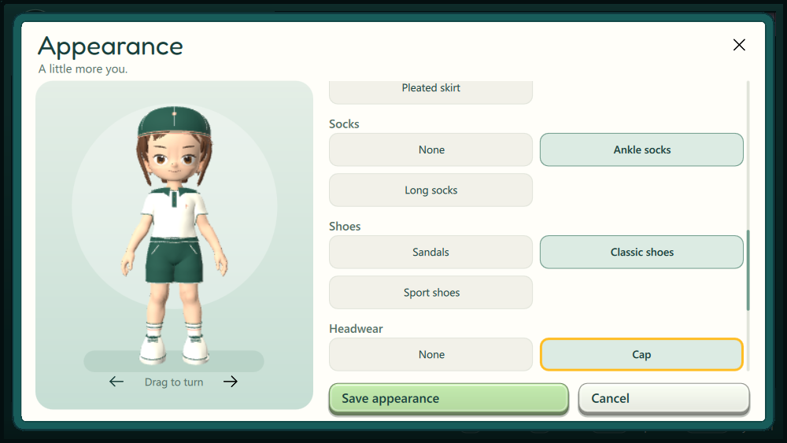
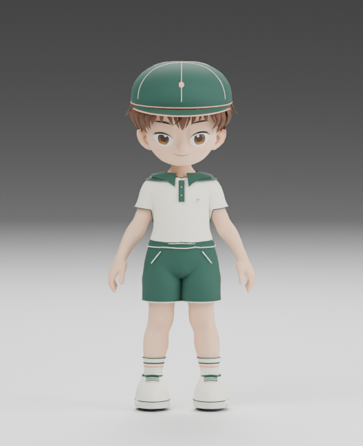
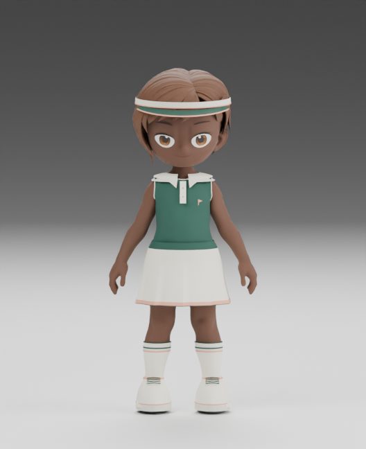

# Гардероб revision 7 — результаты применения

28 октября 2026. [Контракт и механизм](../../AVATAR_WARDROBE_20261028.md).

**Установлено на Odin 2 и Retroid Pocket Flip 2:** одинаковая ARM64-сборка
`fbcbdf0c3a119782708d962a8c0411325c892c18a524dee98857986978458609`,
общий pack revision 7, manifest
`57024e4fea6214b370c62d75ac47fd896473952c7802d495e5fdc9e794e5cd48`.
Оба процесса перезапущены существующим supervisor, новая программа и пакет
проверены; резервные копии оставлены на microSD. Перезагрузка устройств не нужна.

| Проверка | Результат |
| --- | --- |
| Native Avatar | 7/7, затем 4/4: восемь комплектов/причёсок, старый формат, сохранение, все 14 глаз после compact export |
| Backend Accounts client | 23/23 |
| PlatformHost, native и ARM | По 4/4: одежда в `avatar.changed`, неизменная личность, подписка/отзыв |
| ARM Avatar | 5/5: сборка восьми комбинаций, сохранение, изоляция черновика |
| Интерфейс | Touch глаз, контроллер пяти вещей, сохранение/отмена, выбранный предмет виден после уменьшения окна; warnings 0 |
| Установленный гардероб | На Odin/Flip открыт из шапки профиля, пять вещей выбраны навигационными клавишами, показан полный комплект; черновики отменены, исходные образы сохранены |
| Godot | Восемь комбинаций, по пять skinned вещей с 46 corrective shapes, один 54-костный скелет, действия и мимика |
| Backend | 109 тестов на сервере; валидатор установлен, ready, схема 1/2 и прежние цены |
| Живой SDK на двух устройствах | `avatar.get` возвращает schema-2 appearance; `avatar.resolve` собирает комплект, не меняет текущий образ и не присваивает peer локальную личность |
| Godot Compatibility на двух устройствах | По 21 кадру выражений и один прогон сброса/изоляции лицевого состояния; оба прошли |
| Сохранность | Настройки идентичны; `trainer_profile`, `adventures`, `worlds`, `play_sessions` совпадают с резервными копиями; SQLite quick_check ok |

Экспорт полного выбранного комплекта занимает 23,28–24,22 MB по сохранённым
восьми примерам, при лимите SDK 64 MiB. Повторное выполнение
`package_wardrobe.py` даёт тот же manifest. Исходный `template.glb` не изменён.

Во время проверки исправлены состав переносимого пакета (новые бинарные файлы
были исключены общим ignore) и путь временных файлов старого build image.
Это исправлено до установки; окончательные отчёты ARM здесь прошедшие.
Также устранено пересоздание строк редактора при обновлении предпросмотра,
из-за которого прокрутка теряла выбранный элемент.

Отчёты `*-installation.json`, `*-preservation.json`, `*-sdk-live.json` и
`*-sdk-render.json` разделяют установку, данные, живой API и рендер.
Тестовый Godot presenter использовал выбранные экспортированные комплекты;
это отдельная сцена SDK, а не пройденная партия Pocket Golf. Владелец ещё
не проверял физические кнопки и все движения в игре. События игры сами
выбирают эмоции через лицевой API. Odin оставлен с громкостью 0%; Flip —
с прежними 20%. Покупка слота и привязка Patreon/Ko-fi этим проходом не проверялись.
