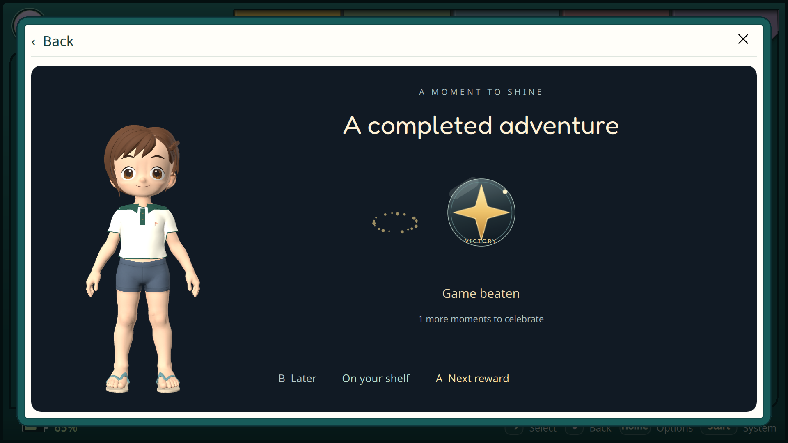
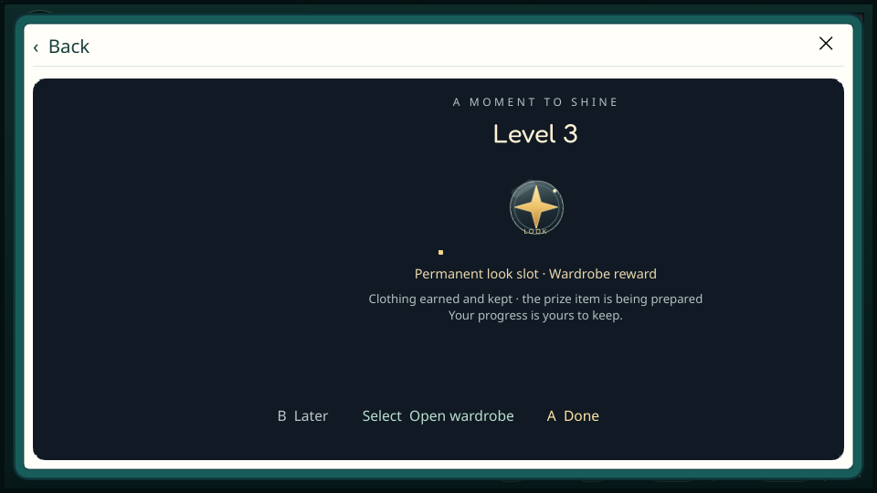

# Вручение по событиям и возврат из игры — 28 октября 2026

Продолжение [общего контракта](../../PLAYER_PROFILE.md), после выдачи прав
в `4335a1ad`. Политика XP/Искр, реальные модели призов и публичный профиль
друга не меняются. Параллельная авторская работа над стартовой/гоночной одеждой
сохранена отдельно; общий установленный avatar pack остаётся revision 7.
Во время проверки соседний чат сохранил её коммитом `d9660f6a`: это авторские
ресурсы `assets/avatar/collections`, документы и инструменты, не подключённые
к текущему CMake/установленному pack. Повторная сборка из-за них не требовалась.

## Что реализовано

- Одна карточка коллекции на игру: прохождение, полный набор и hardcore
  дополняют её. Сервер листает целые группы по последнему факту; старый API
  отдельных фактов сохранён. Уровни имеют собственные карточки коллекции.
- Во вручении одна игра — одна сцена, несколько полученных уровней объединены.
  Состав сцены фиксируется; фоновая синхронизация не заменяет её содержимое.
  Next/Done подтверждает только показанную группу. Ошибка позволяет повтор,
  Later сохраняет непоказанные права, другой владелец не получает эту очередь.
- Полка доступна прямо из сцены: повторное нажатие не снимает экспонат.
  Из наградного слота можно открыть гардероб и вернуться к той же сцене.
  Отсутствующий предмет не подменяется одеждой из базового набора.
- После окончания реально запущенной игры `restoreRequested` ставит
  отложенный показ. До двух минут он ждёт синхронизацию и свободную оболочку;
  ввод текста, входящий звонок, DND и модальные операции не прерываются.
  Новый запуск, другой владелец или явное посещение профиля отменяют ожидание.
  Непоказанное остаётся в уведомлениях. Сворачивание и подготовка без запуска
  не создают этот запрос. Игровой процесс/сохранения вручение не меняет.

## Сервер и клиентские проверки

115 серверных тестов прошли на изолированной PostgreSQL. Новый сценарий
проверяет 103 игры, позднее мастерство первой игры, две страницы без разрезания
групп, целую группу в очереди вручения и отсутствие чужой коллекции.
Прежние проверки выдачи, повторов, прав и цен сохранены.
Развёрнут `traineros-backend:prizeflow28`, схема 11. Backup БД и прежние
исходники/config сохранены. API/worker healthy, чтение без авторизации — 401;
сцены по 250 и слоты по 100 Искр не изменились. Fixtures в рабочую БД не добавлялись.
Осталось прежнее предупреждение Starlette/httpx тестового окружения.

ARM Accounts: **25 passed, 0 failed**, один прежний Windows credential-store
тест пропущен в Linux. Проверены серверная сгруппированная проекция, общая
сцена нескольких уровней, неизменность сцены при новом начислении, сбой/повтор
подтверждения, точные UUID показанной группы и смена владельца.
Avatar/PlatformHost-проверки предыдущей поставки не повторялись:
их контракты и реализация не изменены.

Собран ARM64 Release с Quick3D, сверены 1234 исходных файла. SHA256:
`f95e50ca0b4fcef4cfb1b53588eaf19c9d7ae1a4b144252c49fff07010104e53`.
Сборочные исходники, объекты, контейнеры и резервные копии — на microSD.

## Интерфейс

[ARM GPU-сценарий](online-report.json): success, **0 QML warnings**.
Проверены коллекция/полка, Later, последовательное подтверждение групп,
сенсорный переход в гардероб с возвратом к сцене, действие полки с контроллера,
отсутствие модального вручения поверх активной игры и ожидание окончания ввода.
Сценарий использует отдельные XDG-папки, временную идентичность и fixtures;
настоящему игроку тестовые права не выдавались.

Оконный менеджер Odin растягивает GPU-окно до 1920×1080. Этот прогон подтверждает
3D-персонажа и поведение, но названия файлов wide/compact сами по себе не
доказывают разные размеры. В журнале есть прежнее сообщение об отсутствующем
VDPAU NVIDIA backend; сценарий использует OpenGL и завершается с кодом 0.

[Дополнительный ARM offscreen-сценарий](layout-report.json) прошёл на фактических
1280×720 и 960×540, также без QML warnings. Просмотрены компактная сцена уровня
и коллекция: подписи и действия помещаются. Offscreen не отображает 3D-аватара;
его подтверждает отдельный GPU-прогон выше. Оба прогона — на указанном финальном
бинарнике, с неизменённой общей моделью/гардеробом.

[Коллекция, 960×540](layout-prizes-pending-item-compact.png) ·
[Автопоказ после тестового возврата](prizes-postgame.png).
Это проверка переходов оболочки на контролируемых событиях, а не новое реальное
прохождение игры, отдельная физическая приёмка или прослушивание сигнала.

## Установка на Odin 2 и Flip 2

На обеих консолях установлен и работает бинарник с SHA256 выше. Хэш процесса
совпадает с файлом; штатный supervisor перезапустил оболочку без перезагрузки
устройств. Прежний бинарник и согласованные копии БД/config сохранены на microSD.
Настройки совпали побайтно, четыре проверяемые таблицы профилей/приключений/
истории не изменились; SQLite quick_check — ok. Полный checksum-проход по
пользовательским играм/сохранениям не выполнялся; обновлялся только host binary.
Живые account.identity, avatar.local/recipe, network.group и play.scorecards
доступны. Громкость сохранена: Odin 0%, Flip 20%.

Приватные журналы, source manifest, резервные копии и отчёты установки:
`build/prizeflow28/` и одноимённые каталоги задания на SD. Неизменённые проверки
гардероба/SDK предыдущего шага не объявляются новым игровым прогоном.

## Остаётся отдельно

Полный профиль другого игрока, настройки видимости, входы/возвраты из друзей,
чата, лобби и таблиц и «Посмотреть глазами друга» — следующий согласованный
результат перед Patreon/Ko-fi. Стартовый приз уровня 1 и назначение реальных
призовых вещей ещё открыты. Физические кнопки, прослушивание звука, оценка
владельцем и новое реальное RA-прохождение не заменяются тестовыми событиями.
