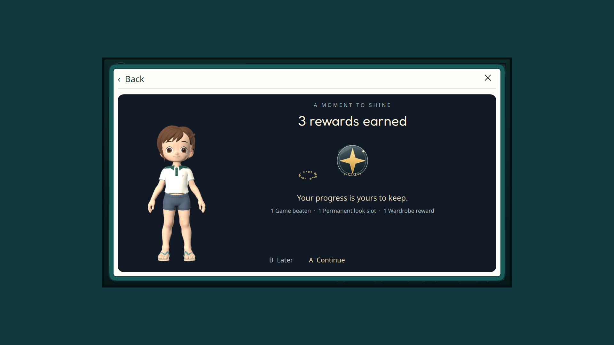
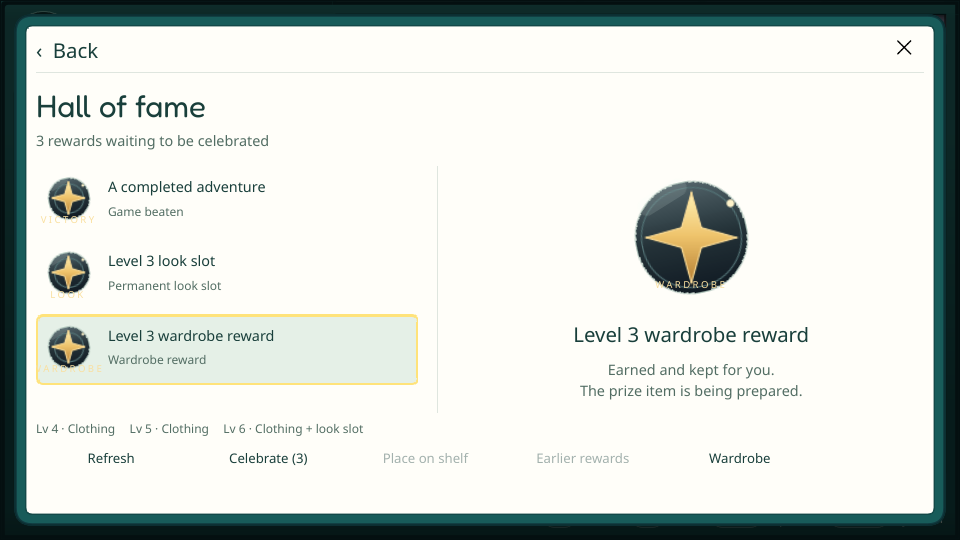

# Призы и собственная витрина — 28 октября 2026

Продолжение согласованного [контракта](../../PLAYER_PROFILE.md).
Изменены существующие Backend Accounts/Economy, инвентарь полных образов
и собственный профиль. [Источники и ограничения выдачи](../../../services/backend/prizes.md).
Новые модели одежды, публичный профиль друга и Patreon этим результатом не заявлены.

## Сервер

114 тестов прошли в отдельном контейнере с изолированной PostgreSQL на сервере.
Проверены догоняющая выдача уровней, конкуренция и повторы, совместное владение
платным/наградным слотом и запись рецепта, старые трофеи без XP/Искр, смена
softcore/hardcore/полного набора, скрытие старого результата, ограниченная
полка, принадлежность прав и невозможность менять/удалять факты runtime-ролью.
HTTP не принимает клиентские grants; нет доступа без аутентификации.
Отдельно проверены типизированные условия прохождения и пустой список
локальных игр при восстановлении публичных наград.

Развёрнут `traineros-backend:prizes28`, миграция 11. Перед миграцией сохранены
backup БД и предыдущие исходники/config. Readiness и worker здоровы,
неавторизованный запрос призов возвращает 401. Каталог прежних сцен по 250
и 16 платных слотов по 100 Искр сохранён. Рабочая БД не наполнялась fixtures.
В тестах осталось известное предупреждение Starlette об устаревающем httpx.

## Клиент и устройства

ARM64 Release собран с Quick3D и текущим общим pack revision 7. SHA256:
`209d68a4efd5d490e1ba58327e1e822add34e8e9c80bd8afe064d7f5aadee13e`.
Accounts: 24 passed, один прежний Windows credential-store test пропущен
в Linux-контейнере. Выбранные Avatar: 7 passed (включая init/cleanup),
PlatformHost: 4 passed (включая init/cleanup). Проверены автосохранение/офлайн,
совместимость рецепта, полный образ и доставка изменения подписанной игре
без смены идентичности. Это не полноценная игровая/физическая приёмка.
Последняя поправка дополнительно проверяет смену онлайн-аккаунта при недоступном
магазине: чужой кеш призов удаляется из памяти и записывается очищенным на диск.
Accounts повторно прошли на финальном бинарнике; прежние Avatar/PlatformHost
проверки сохранены, их реализация после них не менялась.
UI-сценарий Online/профиль/сеты дополнен выбором трофея, записью полки,
открытием вручения, Later без потери наград, подтверждением показанных прав
и точным Back к входу в Зал славы. [Проверка кандидата на реальном GPU](online-report.json)
прошла без QML warnings с временными XDG-папками и тестовой идентичностью.
Композиция с 3D-аватаром проверена на дисплее Odin 1920×1080; оконный менеджер
принудительно растягивает окна, поэтому названия `wide/compact` этого первого
прогона не доказывают два размера.

Дополнительный offscreen-прогон той же реализации интерфейса на ARM проверяет фактическую
геометрию 1280×720 и 960×540, [также без QML warnings](layout-report.json).
В offscreen 3D-аватар не отрисовался; это проверка геометрии/навигации,
а GPU-рендер подтверждён отдельно. В логах обоих запусков есть диагностическое
сообщение поиска отсутствующего VDPAU NVIDIA backend; на ARM использован OpenGL,
процесс и сценарий завершились с кодом 0.

Offscreen-геометрия снята до последней поправки сохранения кеша
(кандидат `57d000ce8f3f`); QML/сцена после неё не менялись. GPU-сценарий
повторён на финальном бинарнике, указанном выше.

[Полка в профиле](prizes-profile-shelf.png) · [Коллекция, 1280×720](layout-prizes-wide.png).
Рабочая учётная запись не получала тестовых наград или покупок.
Промежуточные неудачные сборки не устанавливались.

## Установка

Финальная сборка выше установлена на Odin 2 и Flip 2. Хэши установленных
файлов и работающих процессов совпали. Штатный supervisor перезапустил
оболочку без перезагрузки устройства; прежний бинарник и копии БД/config
сохранены на microSD. Общие avatar assets этим изменением не заменялись.

На обеих консолях настройки совпали побайтно, четыре выбранные таблицы
профилей/приключений/истории сохранили содержимое; SQLite quick_check — ok.
Живой SDK сохранил account.identity, avatar.local/recipe, network.group и
play.scorecards. Громкость Odin — 0%, Flip — прежние 20%.
Это проверка установки/работающей оболочки и сохранности этих данных,
не новая физическая приёмка контроллеров или подтверждение игрового прохождения.

## Открыто

Полный профиль другого игрока, приватность и входы/возвраты из друзей/чата/
лобби/таблиц; группировка полной коллекции по игре и автоматическое вручение
после выхода с прямыми действиями из сцены. Стартовый приз уровня 1 и каталог
реальных вещей ещё не назначены. Физические кнопки, прослушивание звука,
оценка владельцем и новое реальное прохождение RA не подменяются fixtures.
Проверка обычных пользовательских игр/сохранений не проводилась.
