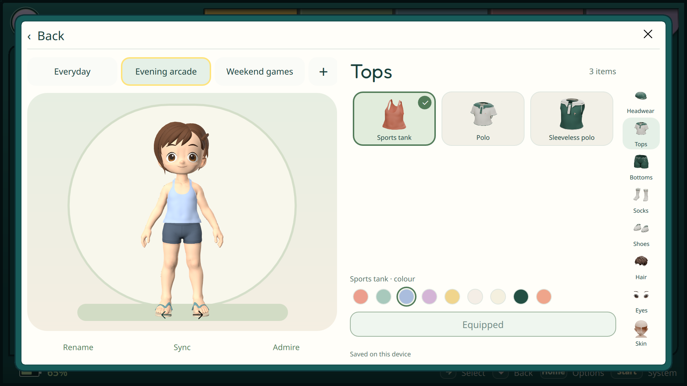
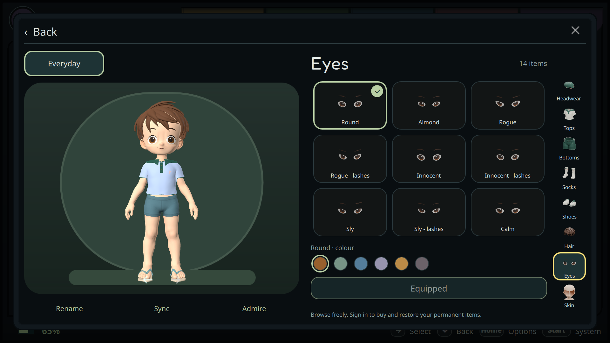

# Игровая гардеробная — 28 октября 2026

Согласованный экран: вкладки полных пользовательских сетов над персонажем,
сетка вещей 3 × 3 справа, категории вертикально вдоль сетки, круги цветов под ней.
Девять ячеек помещаются без обрезки; следующие ряды доступны прокруткой.
Equip / Unequip и смена цвета сразу сохраняют активный сет. Отдельной кнопки
«Применить» нет. Палитра относится к надетой вещи, даже когда выделена другая.

Карточки показывают 32 прозрачных рендера собственных моделей с разными ракурсами.
Персонажа можно поворачивать; выбор лица приближает камеру. Короткое любование
позирует шею, голову и руки, затем возвращает исходную позу. Движение привязано
к bind-матрицам скелета: RuntimeLoader Qt не сохраняет имена узлов GLB, а списки
костей отдельных мешей могут различаться. Используется публичный
[Skin.joints](https://doc.qt.io/qt-6/qml-qtquick3d-skin.html), без private Qt API.

## Сохранение и совместимость

- Бесплатный Everyday и купленные слоты остаются независимыми полными образами.
  Переименование доступно обоим; новый слот по-прежнему стоит 100 Искр навсегда
  и имеет отдельное подтверждение покупки. Предметы одежды бесплатны.
- Локальная очередь сохраняется до отправки, объединяет быстрые правки,
  переживает недоступность сервера и сверяет потерянный ответ по содержимому.
  Конфликт с другой консолью требует выбора версии. Sync повторяет сверку.
- Schema 3 добавляет независимые цвета носков, обуви и головного убора.
  Schema 1/2 остаются совместимыми. Pack revision 7 и его геометрия не меняются.
  Игры продолжают получать общий `avatar.changed`; новый сет не меняет identity.
  Сандалии сохраняют исходный голубовато-серый оттенок, гольфовая обувь — ivory.
  Белая палитра действительно перекрашивает сандалии; тест проверяет материал
  экспортированного GLB. Версия ключа кэша обновлена вместе с разрешением цветов.
- L2/R2 переключают категории. D-pad перемещает фокус по сетам, сетке, палитре
  и действиям; Confirm надевает/снимает или выбирает цвет. Касания используют
  те же операции. Back возвращает в профиль.

## Проверки

Backend: 109 тестов прошли; валидатор трёх appearance-схем развёрнут без миграции
базы и изменения цены. Готовность сервиса и отказ неавторизованному запросу
проверены после замены контейнера. Резервная копия базы и предыдущий образ сохранены.

Native Accounts: 24 теста прошли, включая быстрые правки во время запроса,
восстановление потерянного ответа, конфликт и выбор серверной версии.
Выбранные Avatar-проверки покрывают автономное сохранение, независимость сетов,
ошибку хранилища и совместимость схем.

На ARM прошли Accounts 23 (одна Windows-specific credential-store проверка
пропущена), Avatar 7 и SDK 4. SDK-проверки используют настоящий локальный сокет:
новый образ доходит подписчику, identity сохраняется, смена владельца отзывает
старую подписку. Для тестового контейнера задан существующий отдельный TMPDIR.

Оба UI-сценария дополнительно прошли **на итоговой установленной ARM-сборке**
с временными XDG config/data/cache и изолированным профилем: [аватар](avatar-report.json)
и [Online/сеты](online-report.json), в обоих `success=true`, `warnings=0`.
Проверены касания, семантические действия контроллера, размер 3 × 3,
переход вниз на три карточки, цвета надетого предмета при другом выделении,
Equip / Unequip, повторное открытие, движение костей, сохранённые сеты,
переименование и отдельное подтверждение покупки. Реальные данные владельца
и Искры в этих сценариях не использовались.

[Компактный экран](wardrobe-compact.png) · [Обычная одежда](wardrobe-wide.png).

## Установка на устройства

Одна сборка установлена на Odin 2 и Flip 2. SHA-256 работающих процессов и
установленных файлов совпадает:
`f66fd4c7fec115d2b5088a737e395030b8da751830bdd27e805bfe16ae8a60a8`.
Пакет моделей revision 7 остался прежним. Программа перезапущена штатным
supervisor, без перезагрузки устройств; живой SDK объявляет `avatar.local`,
`avatar.recipe` и прежние возможности.

На обеих консолях проверены открытие гардеробной, вертикальные категории,
девять полных карточек, прокрутка к следующим вариантам и возврат к одежде.
Проверка сохранила прежние данные четырёх таблиц профиля/Adventures/сессий,
целостность SQLite и настройки; резервные копии оставлены. Odin volume = 0.
Касания и кнопки здесь воспроизводились удалённым вводом, физическая приёмка
не подменяется этим результатом.

## Оставшаяся приёмка

Физические кнопки, оценка удобства владельцем и новая полноценная игровая партия
остаются отдельными проверками. Изолированная UI-проверка не списывает реальные
Искры; новая живая покупка владельцем этим отчётом не заявляется. Прежние
подтверждённые проверки моделей и мимики не повторяются и не выдаются за новые.
Следующий ранее согласованный core-пункт — привязка Patreon/Ko-fi и проверка
оплаченного уровня; в эту поставку он не входит.
